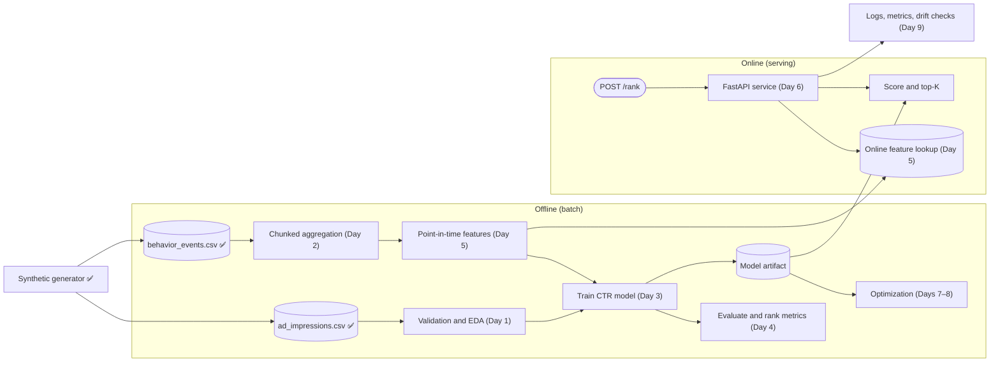

# AdTech MLOps — 10-Day End-to-End Learning Project

A structured, hands-on project in which **two engineers learn together** by building a small advertising machine-learning system from raw events to a tested, benchmarked prediction service. Over ten days it covers:

- AdTech fundamentals and advertising data processing
- Click-through-rate (CTR) prediction and ranking
- Feature engineering and online inference
- Model optimization: quantization, ONNX, pruning, distillation
- Production MLOps, monitoring, and system architecture

New to advertising systems? Start with the [AdTech fundamentals](docs/DAY1.md#part-1--adtech-fundamentals): how one ad request flows from an ad slot through candidate selection, prediction, ranking, and auctions to event logging and retraining.

> **Project status — read this first.** This repository is a **learning scaffold at the start of Day 1**. What exists today is a deterministic synthetic-data generator, two generated CSV datasets, a Day 1 exploration starter, and generator tests. **There is no trained model, ranking module, feature store, API, Docker image, or monitoring system yet.** Those are the deliverables of the roadmap below, and every section of this README marks items as ✅ *implemented*, 🗓️ *planned*, or ➕ *optional*.
>
> **Scope:** Educational prototype, not a production advertising platform. All user IDs and events are synthetic. No production performance, revenue uplift, or causal business effect is claimed.

## Table of contents

1. [Project overview and objectives](#1-project-overview-and-objectives)
2. [What the system does](#2-what-the-system-does)
3. [High-level architecture](#3-high-level-architecture)
4. [Technology stack](#4-technology-stack)
5. [Datasets](#5-datasets)
6. [Repository structure](#6-repository-structure)
7. [Installation and setup](#7-installation-and-setup)
8. [How to run the existing code](#8-how-to-run-the-existing-code)
9. [10-day roadmap](#9-10-day-roadmap)
10. [Daily deliverables and acceptance criteria](#10-daily-deliverables-and-acceptance-criteria)
11. [Testing strategy](#11-testing-strategy)
12. [Collaboration and Git workflow](#12-collaboration-and-git-workflow)
13. [Production ML considerations](#13-production-ml-considerations)
14. [Privacy and security](#14-privacy-and-security)
15. [Project limitations](#15-project-limitations)
16. [Future improvements](#16-future-improvements)

Further documentation:

| Document | Purpose |
|---|---|
| [docs/ROADMAP.md](docs/ROADMAP.md) | Full day-by-day plan: topics, implementation steps, explanation questions |
| [docs/ARCHITECTURE.md](docs/ARCHITECTURE.md) | Current and target architecture, design trade-offs, [core ML system concepts](docs/ARCHITECTURE.md#8-core-ml-system-concepts) (training vs inference vs serving, model size vs data volume, retraining loops) |
| [docs/CONTRIBUTING.md](docs/CONTRIBUTING.md) | Learning method, branching, pull requests, review checklist, definition of done |
| [docs/DAY1.md](docs/DAY1.md) | Day 1 guide: AdTech fundamentals and Pandas data exploration |
| [docs/DAY7.md](docs/DAY7.md) | Day 7 guide: quantization and ONNX |
| [docs/DAY8.md](docs/DAY8.md) | Day 8 guide: pruning and knowledge distillation |

## 1. Project overview and objectives

**Scenario.** A content site has several eligible advertisements for each page view. Given the context available at request time (user, device, hour, recent behavior), the system estimates the probability that the user clicks each candidate ad and returns a ranked list, quickly and reliably.

By the end of Day 10 the project aims to demonstrate:

- [ ] An explanation of the end-to-end ad request lifecycle, plus reproducible data exploration and data-quality checks (Day 1)
- [ ] Memory-efficient, streaming data processing that matches in-memory results (Day 2)
- [ ] A reproducible CTR training pipeline with a saved model artifact and a baseline comparison (Day 3)
- [ ] Classification and ranking evaluation, including Precision@K and NDCG@K (Day 4)
- [ ] Point-in-time-correct behavioral features with simulated offline and online access (Day 5)
- [ ] A tested FastAPI ranking service in Docker with measured p50/p95/p99 latency (Day 6)
- [ ] A small neural baseline with ONNX export and a measured quantization experiment (Day 7)
- [ ] Measured pruning and teacher/student distillation experiments (Day 8)
- [ ] Documented deployment, monitoring, A/B testing, privacy strategy, and end-to-end architecture with scaling and failure analysis (Day 9)
- [ ] A working end-to-end demo from a fresh checkout with all tests passing (Day 10)

**Learning objective.** Both contributors should be able to build, debug, test, and explain **every** major component, not only the parts they wrote.

## 2. What the system does

| Capability | Status | Day |
|---|---|---|
| Generate deterministic synthetic impressions and behavior events | ✅ Implemented ([src/generate_synthetic.py](src/generate_synthetic.py)) | — |
| Print basic dataset shape and click-label counts | ✅ Implemented (starter, [explore_data.py](explore_data.py)) | 1 |
| Data-quality checks and CTR breakdowns | 🗓️ Planned | 1 |
| Chunked/streaming CSV aggregation | 🗓️ Planned | 2 |
| Logistic-regression CTR model, saved artifact | 🗓️ Planned | 3 |
| Classification metrics, top-K ranking, ranking metrics | 🗓️ Planned | 4 |
| Behavioral features, local offline/online feature store | 🗓️ Planned | 5 |
| FastAPI `/health` and `/rank`, Docker, latency benchmark | 🗓️ Planned | 6 |
| Small neural baseline, ONNX export, INT8 quantization benchmark | 🗓️ Planned | 7 |
| Pruning (unstructured and structured) and knowledge distillation experiments | 🗓️ Planned | 8 |
| Drift metric (e.g., PSI) script | ➕ Optional | 9 |
| Deployment, monitoring, experimentation and rollback design; end-to-end architecture | 🗓️ Planned (documentation) | 9 |
| End-to-end demo script, CI on pull requests | 🗓️ Planned / ➕ optional CI | 10 |

**Key distinctions used throughout the project:**

- **CTR prediction** estimates the probability that one impression is clicked.
- **Ranking** orders several eligible candidates for one request. Here it ranks by predicted CTR. Real systems also weigh bids, budgets, pacing, and policy constraints, which are out of scope.
- **Conversion** is a later outcome. The `converted` column exists in the data, but it is never an input to an impression-time CTR model.
- **Training, inference, serving, and evaluation** are different activities. Adding service replicas is not the same as optimizing the model. See [core ML system concepts](docs/ARCHITECTURE.md#8-core-ml-system-concepts).

## 3. High-level architecture

The target system at the end of the roadmap is shown below. **Only the data generator and CSV files exist today.** See [docs/ARCHITECTURE.md](docs/ARCHITECTURE.md) for component details and trade-offs.



## 4. Technology stack

| Layer | Choice | Status |
|---|---|---|
| Language | Python 3.10+ | ✅ (tested locally on Python 3.15) |
| Data | Pandas | ✅ in [requirements-day1.txt](requirements-day1.txt) |
| Data | NumPy | 🗓️ Day 1–2 (installed with Pandas) |
| Modeling | scikit-learn (logistic regression, pipelines), joblib | 🗓️ Day 3 |
| Serving | FastAPI, Pydantic, Uvicorn, httpx (test client) | 🗓️ Day 6 |
| Packaging | Docker | 🗓️ Day 6 |
| Neural models and optimization | PyTorch (CPU), ONNX, ONNX Runtime; skl2onnx optional | 🗓️ Days 7–8 |
| Testing | `unittest` (current); `pytest` optional | ✅ / ➕ |
| Collaboration | Git, GitHub pull requests | ✅ |
| CI | GitHub Actions running tests on pull requests | ➕ Day 10 |

**Out of scope on purpose:** Kafka, Spark, Kubernetes, hosted feature stores, cloud deployment, distributed training, and GPU serving. The architecture documents explain where they would fit, but none of them is needed to finish the roadmap.

Add new dependencies only when the day that needs them begins, and record them in a consolidated `requirements.txt` (🗓️ to be created on Day 3).

## 5. Datasets

Both files are **synthetic**, produced by [src/generate_synthetic.py](src/generate_synthetic.py) with `--users 300 --impressions 15000 --seed 42`. The committed files reproduce byte-for-byte with that command. They contain 15,000 impressions, 16,832 behavior events, and 300 users. Timestamps run from 2026-01-01 to about 2026-01-21 UTC, one impression every two minutes.

### `data/ad_impressions.csv`: one row per ad impression

| Column | Meaning | CTR modeling guidance |
|---|---|---|
| `request_id` | Unique impression identifier | Integrity and deduplication only, **not** a feature |
| `event_time` | UTC impression timestamp (ISO 8601) | Use for time-based splits and serving-time features |
| `user_id` | Synthetic user identifier | Avoid raw high-cardinality IDs in the baseline; use for user-level features |
| `ad_id` | Ad identifier (`ad_1`–`ad_4`, one per category) | Redundant with `ad_category` in this generator |
| `ad_category` | `finance`, `sports`, `shopping`, `travel` | Initial feature |
| `device` | `desktop` or `mobile` | Initial feature |
| `hour` | UTC hour, 0–23 | Initial feature |
| `clicked` | 0/1 observed click | **Target**, never an input |
| `converted` | 0/1 later conversion | **Never** an input to impression-time CTR prediction (leakage) |

### `data/behavior_events.csv`: event log

| Column | Meaning |
|---|---|
| `event_id` | Unique event identifier (suffix `_i`, `_c`, `_v`) |
| `event_time` | UTC timestamp. A click comes 5 s and a conversion 45 s after its impression |
| `request_id` | Links the event back to an impression |
| `user_id`, `ad_id`, `category` | Same meaning as above |
| `event_type` | `impression`, `click`, or `conversion` |

### Generator assumptions and modeling rules

- Each user has one hidden preferred category. Clicks are much more likely when the ad category matches it, and slightly more likely between 18:00 and 22:59 UTC. Device has **no** generated effect.
- **Each `request_id` has exactly one candidate ad.** Multi-candidate ranking evaluation therefore needs constructed candidate sets. See [Day 4](docs/ROADMAP.md#day-4--classification-and-ranking-evaluation).
- A conversion can only follow a click in this generator. That is not a universal attribution rule.
- **Time rule:** a prediction at time *t* may use only information available at or before *t*. Later clicks and conversions are labels, never features for the same prediction.
- If a label is missing in a future dataset, investigate it and report any excluded rows. Do not silently treat it as 0.
- The patterns are intentionally simple and learnable. Good metrics on this data **do not** demonstrate real-world performance.

## 6. Repository structure

### Current files ✅

```text
adtech-mlops/
├── README.md                       # This document
├── .gitignore                      # Virtualenvs, caches, local model artifacts
├── docs/
│   ├── ROADMAP.md                  # Detailed 10-day plan
│   ├── ARCHITECTURE.md             # Current and target architecture
│   ├── CONTRIBUTING.md             # Learning method, collaboration and Git workflow
│   ├── DAY1.md                     # Day 1 guide: AdTech fundamentals + data exploration
│   ├── DAY7.md                     # Day 7 guide: quantization and ONNX
│   └── DAY8.md                     # Day 8 guide: pruning and distillation
├── data/
│   ├── ad_impressions.csv          # Synthetic impressions (generated)
│   └── behavior_events.csv         # Synthetic behavior events (generated)
├── src/
│   ├── __init__.py
│   └── generate_synthetic.py       # Deterministic dataset generator
├── tests/
│   └── test_generate_synthetic.py  # Generator determinism and validity tests
├── explore_data.py                 # Day 1 exploration starter (contains a TODO)
└── requirements-day1.txt           # Pandas
```

### Planned additions 🗓️

These are **plans, not existing files**. Names may change during implementation.

```text
src/
├── data_validation.py     # Day 1   data-quality checks
├── streaming.py           # Day 2   chunked CSV processing and streaming CTR
├── train.py               # Day 3   training pipeline
├── evaluate.py            # Day 4   classification metrics
├── ranking.py             # Day 4   candidate scoring, top-K, Precision@K, NDCG@K
├── features.py            # Day 5   behavioral feature computation
├── feature_store.py       # Day 5   local offline/online feature access
├── api.py                 # Day 6   FastAPI service
├── benchmark.py           # Days 6–8 latency benchmarks
├── nn_model.py            # Day 7   small neural-network baseline
└── optimize.py            # Days 7–8 ONNX export, quantization, pruning, distillation
tests/                     # test_<module>.py for each module above
reports/                   # data_profile.md, model_card.md, latency.md, optimization.md
docs/MLOPS.md              # Day 9   deployment, monitoring, experimentation, guardrails
models/                    # Local artifacts (git-ignored)
requirements.txt           # Consolidated dependencies (from Day 3)
Dockerfile                 # Day 6
```

## 7. Installation and setup

Requirements: Git and Python 3.10 or newer. Docker is needed only from Day 6.

```bash
git clone https://github.com/karanveersingh5623/adtech-mlops.git
cd adtech-mlops

python3 -m venv .venv
source .venv/bin/activate            # Windows PowerShell: .venv\Scripts\Activate.ps1
python -m pip install --upgrade pip
python -m pip install -r requirements-day1.txt
```

Run all commands **from the repository root**. `explore_data.py` uses the relative path `data/ad_impressions.csv`.

**VS Code tip:** open the repository root as the workspace, or set `"cwd": "${workspaceFolder}"` in `.vscode/launch.json`. For robust paths in new scripts, use `Path(__file__).resolve().parent / "data" / "ad_impressions.csv"`.

## 8. How to run the existing code

```bash
# Run the generator tests (standard library only, no Pandas needed)
python -m unittest discover -s tests -v

# Regenerate the datasets. They are already committed; this reproduces them exactly.
python -m src.generate_synthetic --out data --users 300 --impressions 15000 --seed 42

# Day 1 starter: prints shape, first rows, and click-label counts (needs Pandas)
python explore_data.py
```

To experiment without overwriting the committed data, generate into another directory, for example `--out /tmp/adtech-data`. **Do not change the generator or the committed datasets** without a pull request that explains why, because every later day depends on them.

## 9. 10-day roadmap

**Time budget:** about 3–4 hours per person per day, 30–40 hours in total: roughly 45–60 minutes learning, 90–120 minutes building, and 45 minutes testing, review, and explanation. When time is short, finish the required deliverable and skip optional work.

The full plan with implementation steps and explanation questions is in **[docs/ROADMAP.md](docs/ROADMAP.md)**. Days 1, 7, and 8 have dedicated guides.

| Day | Theme | Core topics | Main output |
|---|---|---|---|
| 1 | [AdTech fundamentals, Python and Pandas](docs/DAY1.md) | Ad request lifecycle, ecosystem roles, candidate selection and ranking, event collection; DataFrames, validation, CTR, `groupby`, leakage | Data-quality report, CTR breakdowns, one ad request explained |
| 2 | Python, large files and streaming | Generators, collections, chunked CSV, JSON, malformed records, incremental metrics, testing | Streaming CTR utility with equivalence tests |
| 3 | Classification and model training | Chronological vs random splits, leakage, encoding, pipelines, logistic regression, serialization | Reproducible training pipeline and model artifact |
| 4 | Classification and ranking evaluation | Precision/recall/F1, ROC-AUC, PR-AUC, log loss, calibration, Precision@K, Recall@K, NDCG@K, model vs business metrics | Evaluation and ranking modules with tests |
| 5 | Feature engineering and feature stores | User and ad aggregates, freshness, point-in-time correctness, training-serving skew, delayed conversions | Feature pipeline and local feature store |
| 6 | Low-latency inference and serving | Inference vs serving, FastAPI, Docker, p50/p95/p99, batching, concurrency, horizontal scaling, caching, CPU/GPU | Inference API, Docker, latency benchmark |
| 7 | [Optimization I: quantization and ONNX](docs/DAY7.md) | FP32/FP16/INT8, scale and zero point, dynamic vs static, PTQ vs QAT, ONNX Runtime, parity | Neural baseline, ONNX export, quantization benchmark |
| 8 | [Optimization II: pruning and distillation](docs/DAY8.md) | Magnitude pruning, structured vs unstructured, sparsity, fine-tuning; teacher/student, soft targets, temperature | Pruning and distillation experiments, benchmark summary |
| 9 | Production MLOps and system architecture | Versioning, shadow/canary/champion-challenger, A/B tests, drift, retraining, rollback, SLOs, PII, capacity, failures | Architecture diagram, deployment, monitoring and experimentation design |
| 10 | Integration, validation and independent problem-solving | End-to-end run, testing, benchmarking, independent Python problems, debugging, code review | Working demo, consolidated benchmarks, final review |

## 10. Daily deliverables and acceptance criteria

Each day ends with a merged pull request that meets the [definition of done](docs/CONTRIBUTING.md#definition-of-done) **and** the criteria below.

| Day | Required deliverables | Accepted when |
|---|---|---|
| 1 | Reproducible EDA script; data-quality checks (missing values, duplicates, label domain, hour range, unique values); CTR by device and category with counts; `reports/data_profile.md` with patterns, limitations, and a walkthrough of one end-to-end ad request | Both contributors reproduce the profile from one command, data-validation tests pass, and both can explain the ad-request lifecycle and why `clicked` and `converted` are not features |
| 2 | Chunked CSV utility; streaming CTR aggregation; tests comparing streaming and in-memory results; memory/runtime notes | Streaming and in-memory CTRs match exactly for several chunk sizes, including chunk sizes that do not divide the row count, and bad input raises clear errors |
| 3 | `src/train.py`; constant-rate baseline and logistic regression; saved artifact; short evaluation report (`reports/model_card.md`) | One command retrains with the same split and seed and gives the same metrics; preprocessing is fitted only on training data; the split method and leakage checks are documented |
| 4 | Classification evaluation module (including F1 and calibration); top-K ranking; Precision@K, Recall@K and NDCG@K with hand-computed test cases; written comparison of classification vs ranking objectives | Metric functions match hand-worked examples, including one where good AUC coexists with poor ranking; ranking is deterministic; the candidate-set construction and its limitations are documented |
| 5 | Behavioral feature pipeline; simulated offline (batch) and online (lookup) access; feature validation tests; architecture notes | Tests prove that events after the scoring time never affect features, and that offline and online paths return identical values for the same entity and timestamp |
| 6 | FastAPI `GET /health` and `POST /rank`; API tests; `Dockerfile`; latency benchmark (`reports/latency.md`); scaling trade-off notes | API tests pass; the container builds and serves a request; p50/p95/p99 are **measured** with stated hardware, warm-up, and concurrency; invalid input returns 4xx, not 500 |
| 7 | Small FP32 neural baseline; ONNX export; INT8 quantization experiment; FP32 vs optimized benchmark of size, latency, quality, and memory where practical (`reports/optimization.md`) | Export parity is within a stated tolerance; quantized quality is measured; results are reproducible; a missing speed-up is reported and explained ([criteria](docs/DAY7.md#acceptance-criteria)) |
| 8 | Pruning experiment (unstructured and structured); teacher/student distillation experiment; combined benchmark summary; guidance on when each technique fits | Sparsity, quality, size, and latency are measured; the notes explain why dense zeros do not speed up inference; the rebuilt pruned model matches the masked one within tolerance; the students are compared with matched settings ([criteria](docs/DAY8.md#acceptance-criteria)) |
| 9 | `docs/MLOPS.md` (deployment, monitoring and alerting, experimentation, privacy and guardrails); complete architecture diagram; scaling and failure-handling analysis in [docs/ARCHITECTURE.md](docs/ARCHITECTURE.md) | Every alert has a metric, a threshold rationale, and an action; rollback is concrete; the A/B design states the unit, metrics, and sample-size reasoning; the diagrams match the code; every failure mode has detection and mitigation |
| 10 | End-to-end demo; passing applicable tests; verified setup; consolidated benchmarks; architecture and trade-off report; independent problem-solving exercises | A fresh clone reaches a ranked API response by following only the README, and both contributors can independently solve small Python problems and debug an injected bug |

## 11. Testing strategy

| Level | What it covers | Status |
|---|---|---|
| Generator tests | Determinism, `clicked` label domain, hour consistency, conversion-after-click, unique and ordered events | ✅ [tests/test_generate_synthetic.py](tests/test_generate_synthetic.py), 2 tests |
| Data validation | Schema, nulls, duplicates, value domains | 🗓️ Day 1 |
| Equivalence tests | Streaming vs in-memory results; offline vs online features | 🗓️ Days 2, 5 |
| Leakage tests | Future events and post-outcome columns never reach features | 🗓️ Days 3, 5 |
| Metric tests | Precision@K, NDCG@K, log loss against hand-computed values | 🗓️ Day 4 |
| API tests | Valid and invalid requests, empty candidates, missing model | 🗓️ Day 6 |
| Numerical parity | ONNX vs original predictions; rebuilt pruned model vs masked model | 🗓️ Days 7–8 |
| End-to-end smoke test | Generate → train → serve → rank | 🗓️ Day 10 |

Principles:

- Run `python -m unittest discover -s tests -v` before every pull request. Every new module gets a `tests/test_<module>.py`.
- Use small, generated fixtures, such as `generate(tmp, users=20, impressions=1000, seed=14)`, so tests run in seconds.
- Test behavior and invariants, not implementation details. Prefer exact expected values where they can be worked out by hand.
- Performance numbers belong in reports, not in assertions. Benchmarks are not unit tests.

## 12. Collaboration and Git workflow

Both contributors share ownership of the architecture and code. Nobody owns a component. Each day's work is split into small tasks, and the two contributors **alternate** who implements and who reviews, so each of them builds part of every layer.

**Learning method:**

- Contributors write their own solutions. The guides give requirements, hints, and acceptance criteria, never finished answers.
- Reviews focus on reasoning.
- Every day ends with verification and an explanation.

See [CONTRIBUTING.md](docs/CONTRIBUTING.md#learning-method).

Summary (details in [docs/CONTRIBUTING.md](docs/CONTRIBUTING.md)):

1. Keep `main` green; do not commit to it directly.
2. Branch per task: `day3/train-pipeline`, `day6/rank-endpoint`, `docs/monitoring-design`.
3. Make small commits that each do one thing, with clear messages.
4. Open a pull request with what changed, how it was tested, and its assumptions and limitations.
5. The other contributor reviews, runs the tests locally, and should be able to explain the change before approving.
6. At the end of each day, run the full test suite on `main` together and update the roadmap checkboxes.

Treat AI coding-assistant output as an untrusted draft: read it, test it, and make sure you can explain it. Each contributor should also implement and debug some work without assistance.

## 13. Production ML considerations

The project runs locally, but each day connects to a production concern:

| Concern | How the project addresses it |
|---|---|
| Data quality | Validation checks before training and at the API boundary (Days 1, 6) |
| Leakage and point-in-time correctness | Time-based splits and past-only features with tests (Days 3, 5) |
| Training-serving skew | One shared feature code path; the fitted preprocessing pipeline is saved with the model (Days 3, 5, 6) |
| Latency | Measured p50/p95/p99 under stated load; batched scoring; the model is loaded once at startup (Day 6) |
| Model efficiency | Quantization, pruning, and distillation measured against an FP32 baseline; distinguished from scaling replicas (Days 7–8) |
| Reliability | Explicit handling of missing artifacts, empty candidates, and feature-store misses with defaults (Day 6) |
| Model versioning | A version string stored with each artifact and returned by the API (Days 3, 6) |
| Retraining and safe rollout | Retraining produces a candidate, not an automatic replacement; shadow, canary, champion/challenger, and A/B designs; rollback (Day 9, [retraining loop](docs/ARCHITECTURE.md#83-retraining-and-feedback-loops)) |
| Monitoring | Service metrics, feature and prediction drift, delayed-label performance, model freshness, latency SLOs (Day 9) |
| Cost and performance | Optimization trade-offs and capacity estimates (Days 7–9) |

## 14. Privacy and security

- **All data is synthetic.** No real user data may be committed. Any real dataset would need a separate privacy review, and the review would happen before the data is used.
- Treat `user_id` as a pseudonymous identifier. In logs, record request IDs, model version, latency, and outcome, not raw user identifiers or full request payloads.
- Never commit secrets, tokens, `.env` files, or credentials. `.gitignore` excludes common local files, but review `git diff --staged` before every commit.
- Do not commit large binary model artifacts. `models/` is git-ignored, and artifacts should be reproducible from code and a seed.
- Validate all API inputs and bound request sizes, such as the maximum number of candidates (Day 6).
- Day 9 covers PII minimization, retention, access control, and consent considerations in more depth.

## 15. Project limitations

- **Synthetic data:** click patterns are generated by simple rules, so metrics show learning on known patterns, not real-world performance.
- **One candidate per request:** the logs record only the ad that was shown. Ranking metrics need constructed candidate sets, and offline ranking results cannot be read as unbiased estimates of online performance.
- **No economics:** there are no bids, budgets, pacing, or auctions. Ranking uses predicted CTR only.
- **Local only:** the feature store is an in-process simulation, and nothing is deployed to cloud infrastructure.
- **Small models:** the Day 7–8 networks are deliberately tiny so that the experiments fit in a day. Optimization techniques may show little or no latency gain at this size; the guides require such results to be measured and explained, not hidden.
- **No live traffic:** A/B testing and monitoring are designed and simulated, not run against real users.

## 16. Future improvements

➕ Optional extensions after Day 10, roughly in order of learning value:

- A chronological train/validation/test pipeline with a calibration analysis (reliability curve, Brier score)
- An embedding-based CTR model (user and ad embeddings), to study how vocabulary size drives model size
- Quantization-aware training and static quantization with calibration, beyond the Day 7 post-training experiment
- A public click-log dataset to test the pipeline on realistic data
- Rule-based or learned audience eligibility from behavioral features
- Event streaming with a local broker, and a real online store such as Redis
- Off-policy or counterfactual evaluation for ranking
- CI with test, lint, and container-build checks; load testing at higher concurrency
- Container orchestration and cloud deployment

---

**License:** not yet selected. Add one before inviting reuse or contributions from outside the project team.
