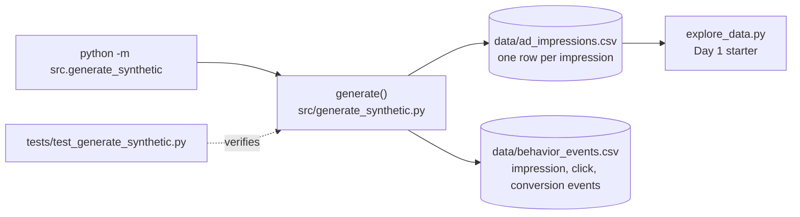
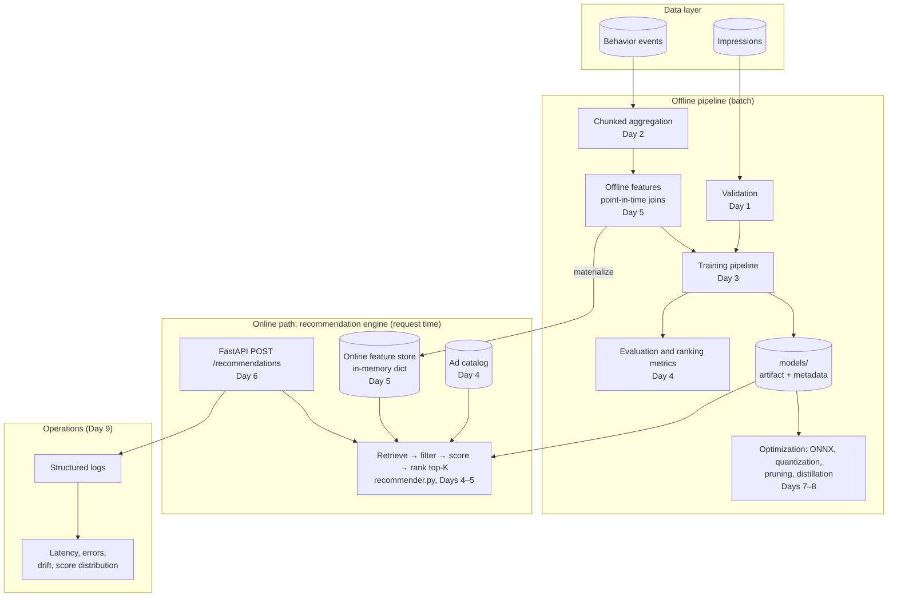
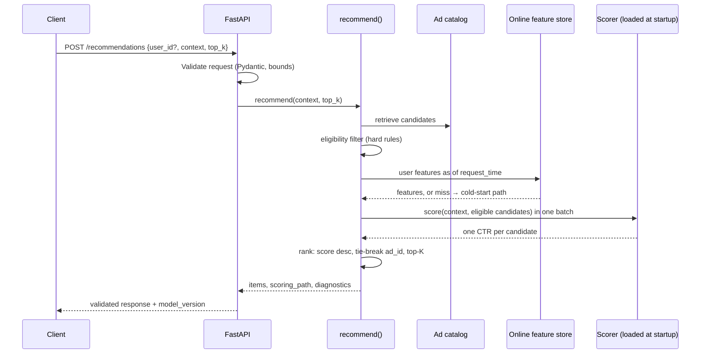
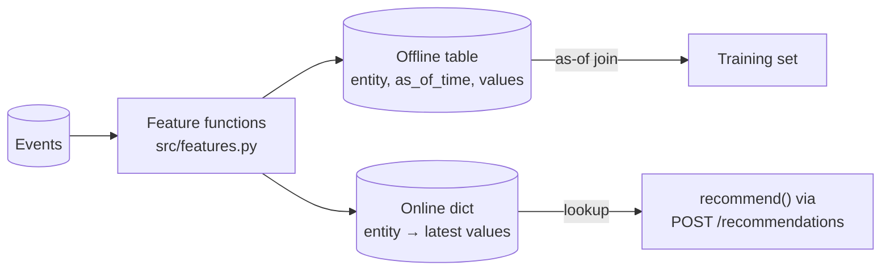
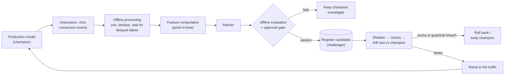

# Architecture

This document describes the system **as it exists today** and the **target architecture** the [roadmap](ROADMAP.md) builds toward. It is a living document. Day 5 adds the feature-store details and Day 9 expands it into a full system design. Whenever the code changes, update the diagrams in this file so that they keep matching it.

Background reading:

- For how a real ad request flows through publishers, exchanges, and ranking services, read the [AdTech fundamentals in Day 1](DAY1.md#part-1--adtech-fundamentals).
- For the vocabulary used on Days 3–9, read [Core ML system concepts](#8-core-ml-system-concepts): training vs inference vs serving vs evaluation, model size vs data volume, and retraining loops.
- For the central deliverable, read the [Recommendation Engine Specification](RECOMMENDER.md): interfaces, the API contract, and the evaluation fixtures.

Status markers: ✅ implemented · 🗓️ planned · ➕ optional.

## 1. Current state ✅

Only the data layer exists.

**Generator behavior.** All of this comes from the code, not from assumptions:

- Seeded `random.Random` makes the output byte-identical for the same arguments.
- One impression is written every 2 minutes from 2026-01-01T00:00Z. `hour` is derived from `event_time`.
- Each user gets a hidden preferred category. The click probability is 0.05, plus 0.22 if the category matches the preference, plus 0.035 for hours 18–22. Device has no effect.
- A conversion is possible only after a click, with a higher probability when the category matches the preference.
- Events are written at the impression time, then +5 s for a click and +45 s for a conversion, sorted by `(event_time, event_id)`.

## 2. Target architecture 🗓️

### Request flow for `POST /recommendations` 🗓️

The full contract is in [RECOMMENDER.md](RECOMMENDER.md#7-day-6-post-recommendations).

## 3. Components and planned modules

| Component | Planned module | Responsibility | Key invariant |
|---|---|---|---|
| Data generator ✅ | `src/generate_synthetic.py` | Reproducible synthetic data | Same arguments → identical bytes |
| Validation 🗓️ | `src/data_validation.py` | Schema, domains, duplicates, cross-file consistency | Fails loudly on invalid data |
| Streaming 🗓️ | `src/streaming.py` | Constant-memory aggregation | Equal to the in-memory result |
| Training 🗓️ | `src/train.py` | Split, preprocess, fit, save artifact and metadata | Preprocessing fitted on training data only |
| Evaluation 🗓️ | `src/evaluate.py` | Classification metrics vs baseline | Always reported with split description |
| Catalog and retrieval 🗓️ | `src/catalog.py`, `src/retrieval.py` | Load the ad catalog; return bounded candidates | Only catalog ads; deterministic |
| Eligibility 🗓️ | `src/eligibility.py` | Hard rules: status, device, schedule, blocked categories | No score overrides a rule |
| Scoring 🗓️ | `src/scoring.py` | Context-only (Day 4) and personalized (Day 5) scorers | One probability per candidate, one batched call |
| Ranking 🗓️ | `src/ranking.py`, `src/ranking_metrics.py` | Top-K; Precision@K, Recall@K, NDCG@K | Deterministic order; unknown labels raise |
| Recommender 🗓️ | `src/recommender.py` | Orchestrates retrieve → filter → features → score → rank | Returns only eligible ads; reports scoring path |
| Features 🗓️ | `src/features.py`, `src/feature_store.py` | Point-in-time features; offline and online access | No events at or after request time; offline equals online |
| Serving 🗓️ | `src/api.py` | `POST /recommendations`: request and response validation | 4xx for bad input; output invariants hold; model loaded once |
| Benchmark 🗓️ | `src/benchmark.py` | p50/p95/p99, throughput | Numbers reported with conditions |
| Optimization 🗓️ | `src/nn_model.py`, `src/optimize.py` | Small neural baseline; ONNX export, quantization (Day 7); pruning, distillation (Day 8) | Quality and parity measured against the FP32 baseline |

## 4. Key design decisions and trade-offs

| Decision | Choice | Alternative | Why |
|---|---|---|---|
| Model | Logistic regression in a scikit-learn `Pipeline` | Gradient boosting, neural CTR models | Fast, explainable, and stores preprocessing with the model, which prevents skew |
| Split | Time-based, with a random split for comparison | Random only | Mirrors deployment: train on the past, predict the future |
| Features | Shared feature functions used by both offline and online paths | Separate SQL for batch and Python for serving | One implementation reduces training-serving skew |
| Feature store | Local DataFrame plus in-memory dict | Feast, Redis, a managed store | Teaches the concepts without infrastructure. See section 5 |
| Serving | Synchronous FastAPI, model in process | Separate model server, batching | Simplest path for a small CPU model |
| Artifacts | `models/` git-ignored, reproducible from code and seed | Committed binaries | Keeps the repository small and auditable |

## 5. Feature store (Day 5) 🗓️

The project simulates the two halves of a feature store:

- **Offline store:** historical feature values with timestamps, used to build training sets by point-in-time (as-of) joins, so that each training row only sees events strictly before its impression time.
- **Online store:** the latest feature values per entity, materialized as of a recorded time and kept in memory for low-latency lookup at request time. Unknown entities are reported as misses, and the recommender sends them to the [cold-start path](RECOMMENDER.md#63-cold-start-fallback).

**What a production feature store adds** and why this project leaves each one out:

- A feature registry and definitions.
- Scheduled materialization and backfills.
- TTL and freshness monitoring.
- Low-latency distributed storage.
- Access control.

This project covers the core correctness ideas (point-in-time joins, parity, freshness) with a few hundred rows per user, so none of that infrastructure is needed.

## 6. Scaling, reliability and failure modes

**Preliminary.** Day 9 expands this section with measured numbers and capacity estimates.

| Component | Failure | Impact | Planned mitigation |
|---|---|---|---|
| Model artifact | Missing or corrupt at startup | Service cannot score | Fail health check at startup; keep the previous version for rollback |
| Online features | Unknown user or store unavailable | Lower-quality scores | Fall back to the context-only cold-start scorer; count misses as a metric |
| Input | Malformed or oversized request | Errors, latency spikes | Pydantic validation; maximum candidate count; 4xx responses |
| Data | Schema change, bad labels | Silent model degradation | Validation before training; drift monitoring (Day 9) |
| Latency | Slow inference or many candidates | Missed request deadlines | Benchmark p99; bound candidates; optimize the model (Days 7–8); scale replicas for throughput |
| Retraining | New model is worse, or trained on biased or leaked data | Lower quality after deployment | Evaluation gate, champion/challenger, staged rollout, rollback (section 8.3) |

## 7. Out of scope

The following items are **not** part of the target architecture. Day 9 discusses where they would fit:

- Message brokers such as Kafka
- Distributed processing such as Spark or Flink
- Orchestration such as Kubernetes
- Managed feature stores and model registries
- Real-time bidding and auctions
- GPU serving

## 8. Core ML system concepts

These distinctions come up on almost every day of the roadmap. Each one connects a theoretical idea to a production decision.

### 8.1 Training, inference, serving and evaluation

| Term | What happens | Changes model parameters? | Main concerns |
|---|---|---|---|
| **Training** | An optimizer updates parameters to reduce a loss on training data | Yes | Data volume, compute time, convergence, leakage, reproducibility |
| **Inference** | The trained model computes predictions from input features | No | Per-prediction compute, numerical precision, latency of one call |
| **Serving** | Inference is made available to other systems, for example through an API | No | Routing, request validation, concurrency, batching, scaling, versioning, monitoring, fallbacks, reliability |
| **Evaluation** | Prediction quality or business outcomes are measured with appropriate data and metrics | No | Correct splits, labels, metric choice, offline vs online validity |

Two common confusions:

- **Inference is not evaluation.** Inference produces a score, and it can run with no label at all, which is the normal case online. Evaluation compares scores with known outcomes, using metrics such as log loss, AUC, or NDCG. Evaluation *uses* inference, but it also needs labels and a metric.
- **Scaling the service is not optimizing the model.** Adding replicas (horizontal scaling, for example more pods) increases **throughput**: more requests per second in total. When the service is saturated, it also cuts queueing delay, so the observed p95/p99 drops. It does not make one prediction compute faster, and it multiplies cost. Model optimization (Days 7–8) reduces the **cost of each inference**: fewer operations, smaller numbers, smaller memory footprint. That can lower latency and raise throughput per replica. Production systems usually need both.

### 8.2 Model size vs data volume

**More training data does not, by itself, make a fixed-architecture model larger.**

- **A fixed architecture has a fixed parameter count.** Training changes the parameter *values*, not how many parameters there are.
- **Parameter magnitude does not change storage.** An FP32 parameter takes 4 bytes whether its value is 0.001 or 1,000. Compressed archives can differ slightly with the values; the in-memory size and the compute do not.
- **Model size changes when one of these changes:**
  - the architecture (more layers or wider layers)
  - the parameter count
  - the size of vocabularies and embedding tables
  - the numerical representation (FP32 → FP16 → INT8)
- **Data volume changes training, not inference.** More data means more training compute, a larger data pipeline, more memory and storage for features, and longer retraining. It does not change the cost of one inference.

**Numerical illustration.** Consider a small multilayer perceptron (MLP) for this project's one-hot inputs. The inputs are 2 device values, 4 categories, and 24 hours, giving 30 features. The layers are 30 → 64 → 32 → 1.

| Layer | Weights | Biases | Parameters |
|---|---|---|---|
| 30 → 64 | 1,920 | 64 | 1,984 |
| 64 → 32 | 2,048 | 32 | 2,080 |
| 32 → 1 | 32 | 1 | 33 |
| **Total** | | | **4,097** |

| | 15,000 training rows | 1,500,000 training rows |
|---|---|---|
| Parameters | 4,097 | 4,097 (unchanged) |
| FP32 weights | ≈ 16 KB | ≈ 16 KB (unchanged) |
| FP16 / INT8 weights | ≈ 8 KB / ≈ 4 KB, plus a small overhead for INT8 scales | same |
| Inference compute per example (≈ 2 × parameters) | ≈ 8,200 floating-point operations | ≈ 8,200 (unchanged) |
| Training compute per epoch (rule of thumb ≈ 6 × parameters × rows) | ≈ 3.7 × 10⁸ operations | ≈ 3.7 × 10¹⁰ operations (100×) |

**Where data *does* grow the model: embedding tables.** If the model learns a 16-dimensional embedding per user, then:

- 300 users need 4,800 parameters, about 19 KB in FP32.
- 10 million users need 160 million parameters, about 640 MB in FP32.

Here more data means more distinct IDs, so the *vocabulary* grows, and the model grows with it. This is why production CTR models are often dominated by embedding tables, and why their size is managed with hashing, frequency cut-offs, or lower precision.

**Why this matters for system design:**

- Training scalability is about data throughput, distributed compute, and retraining time.
- Inference scalability is about per-request latency, model memory per replica, and request volume.
- They are different problems with different solutions.

### 8.3 Retraining and feedback loops

1. **Event collection.**
   - Impressions are logged when an ad is shown.
   - Clicks are logged within seconds of the impression.
   - Conversions can take hours or days to arrive.
2. **Offline processing.** Events are deduplicated and joined to their impressions. A training example is labeled only after its label window has closed.
3. **Feature computation.** Features are rebuilt with point-in-time correctness (Day 5).
4. **Retraining.** A new model is trained on a recent time window.
5. **Evaluation and approval.** The new model is compared with the current production model on the *same* held-out period, using quality metrics, calibration, and sanity checks. A failing model goes no further.
6. **Candidate registration.** An approved model is stored with its version, data window, metrics, and code version. It is now a *challenger*, not yet in production.
7. **Champion/challenger comparison.** The challenger is first run in shadow, scoring live traffic without affecting decisions. It then receives a small canary share of traffic to check operational health. Finally it is tested in an A/B test against the current *champion* to measure outcomes.
8. **Controlled deployment and rollback.** A challenger that wins is ramped up to full traffic. If guardrail metrics degrade at any stage, traffic returns to the previous version.

**Retraining does not mean automatic replacement.** A freshly trained model is only a candidate. Promotion requires passing evaluation and online comparison, and the previous version stays available for rollback.

**Learning topics in this loop:**

- **Delayed labels.**
  - Conversions arrive late, so recent impressions look like non-conversions until their attribution window closes.
  - Training on them too early biases the model downward.
  - Monitoring that uses them too early reports a false drop in quality.
- **Feedback loops.** The model decides which ads are shown, and only shown ads produce labels. The next model is therefore trained on data shaped by the previous one. Ads the model underrates are rarely shown, so the mistake is rarely corrected.
- **Selection and exposure bias.** Logged data covers only the candidates that were shown, in the positions where they were shown. Offline metrics computed on this data do not measure what would have happened under a different policy. Common mitigations are a small exploration share of traffic, position-aware modeling, and counterfactual (off-policy) evaluation.

This project simulates the offline half of the loop (Days 3–5) and designs the online half (Day 9). It does not run live experiments.
