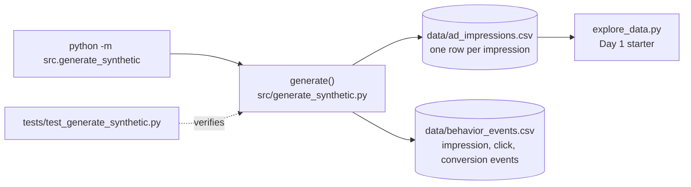
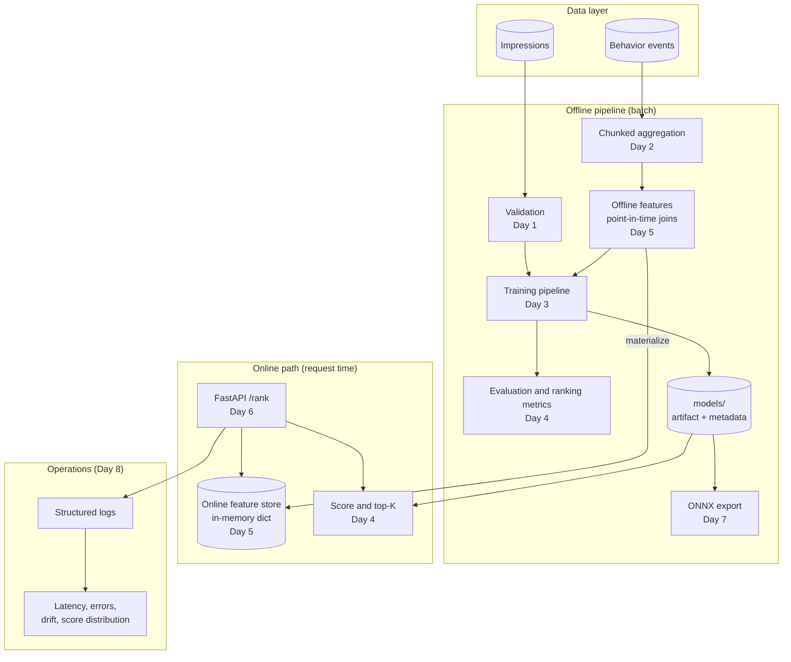
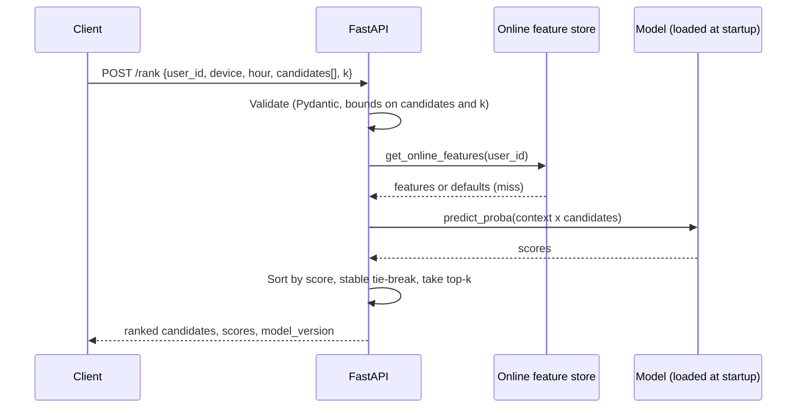
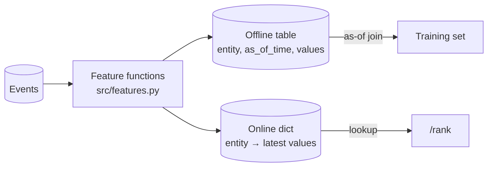

# Architecture

This document describes the system **as it exists today** and the **target architecture** the [roadmap](ROADMAP.md) builds toward. It is a living document. Day 5 adds the feature-store details and Day 9 expands it into a full system design. Whenever the code changes, update the diagrams in this file so that they keep matching it.

Status markers: ✅ implemented · 🗓️ planned · ➕ optional.

## 1. Current state ✅

Only the data layer exists.

**Generator behavior.** All of this comes from the code, not from assumptions:

- Seeded `random.Random` makes the output byte-identical for the same arguments.
- One impression is written every 2 minutes from 2026-01-01T00:00Z. `hour` is derived from `event_time`.
- Each user gets a hidden preferred category. The click probability is 0.05, plus 0.22 if the category matches the preference, plus 0.035 for hours 18–22. Device has no effect.
- A conversion is possible only after a click, with a higher probability when the category matches the preference.
- Events are written at the impression time, then +5 s for a click and +45 s for a conversion, sorted by `(event_time, event_id)`.

## 2. Target architecture 🗓️

### Request flow for `POST /rank` 🗓️

## 3. Components and planned modules

| Component | Planned module | Responsibility | Key invariant |
|---|---|---|---|
| Data generator ✅ | `src/generate_synthetic.py` | Reproducible synthetic data | Same arguments → identical bytes |
| Validation 🗓️ | `src/data_validation.py` | Schema, domains, duplicates, cross-file consistency | Fails loudly on invalid data |
| Streaming 🗓️ | `src/streaming.py` | Constant-memory aggregation | Equal to the in-memory result |
| Training 🗓️ | `src/train.py` | Split, preprocess, fit, save artifact and metadata | Preprocessing fitted on training data only |
| Evaluation 🗓️ | `src/evaluate.py` | Classification metrics vs baseline | Always reported with split description |
| Ranking 🗓️ | `src/ranking.py` | Top-K, Precision@K, NDCG@K | Deterministic order |
| Features 🗓️ | `src/features.py`, `src/feature_store.py` | Point-in-time features; offline and online access | No future events; offline equals online |
| Serving 🗓️ | `src/api.py` | HTTP validation, scoring, response | 4xx for bad input; model loaded once |
| Benchmark 🗓️ | `src/benchmark.py` | p50/p95/p99, throughput | Numbers reported with conditions |
| Optimization 🗓️ | `src/optimize.py` | ONNX export and comparison | Prediction parity within tolerance |

## 4. Key design decisions and trade-offs

| Decision | Choice | Alternative | Why |
|---|---|---|---|
| Model | Logistic regression in a scikit-learn `Pipeline` | Gradient boosting, neural CTR models | Fast, explainable, and stores preprocessing with the model, which prevents skew |
| Split | Time-based, with a random split for comparison | Random only | Mirrors deployment: train on the past, predict the future |
| Features | Shared feature functions used by both offline and online paths | Separate SQL for batch and Python for serving | One implementation reduces training-serving skew |
| Feature store | Local DataFrame plus in-memory dict | Feast, Redis, a managed store | Teaches the concepts without infrastructure. See section 5 |
| Serving | Synchronous FastAPI, model in process | Separate model server, batching | Simplest path for a small CPU model |
| Artifacts | `models/` git-ignored, reproducible from code and seed | Committed binaries | Keeps the repository small and auditable |

## 5. Feature store (Day 5) 🗓️

The project simulates the two halves of a feature store:

- **Offline store:** historical feature values with timestamps, used to build training sets by point-in-time (as-of) joins, so that each training row only sees events strictly before its impression time.
- **Online store:** the latest feature values per entity, kept in memory for low-latency lookup at request time, with defaults for unknown entities.

**What a production feature store adds** and why this project leaves each one out:

- A feature registry and definitions.
- Scheduled materialization and backfills.
- TTL and freshness monitoring.
- Low-latency distributed storage.
- Access control.

This project covers the core correctness ideas (point-in-time joins, parity, freshness) with a few hundred rows per user, so none of that infrastructure is needed.

## 6. Scaling, reliability and failure modes

**Preliminary.** Day 9 expands this section with measured numbers and capacity estimates.

| Component | Failure | Impact | Planned mitigation |
|---|---|---|---|
| Model artifact | Missing or corrupt at startup | Service cannot score | Fail health check at startup; keep the previous version for rollback |
| Online features | Unknown user or store unavailable | Lower-quality scores | Fall back to default feature values; count misses as a metric |
| Input | Malformed or oversized request | Errors, latency spikes | Pydantic validation; maximum candidate count; 4xx responses |
| Data | Schema change, bad labels | Silent model degradation | Validation before training; drift monitoring (Day 8) |
| Latency | Slow inference or many candidates | Missed request deadlines | Benchmark p99; bound candidates; optimize (Day 7); scale replicas |

## 7. Out of scope

The following items are **not** part of the target architecture. Day 9 discusses where they would fit:

- Message brokers such as Kafka
- Distributed processing such as Spark or Flink
- Orchestration such as Kubernetes
- Managed feature stores and model registries
- Real-time bidding and auctions
- GPU serving
