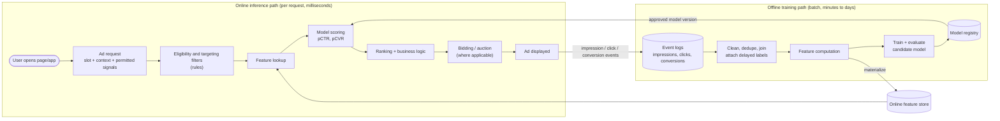

# Day 1 — AdTech Fundamentals, Python and Pandas

Guided exercise for [Day 1 of the roadmap](ROADMAP.md#day-1--adtech-fundamentals-python-and-pandas). Starter code: [explore_data.py](../explore_data.py). Run everything from the repository root after following the [setup steps](../README.md#7-installation-and-setup).

Day 1 has two parts:

1. **[AdTech fundamentals](#part-1--adtech-fundamentals)** (about 1 hour): how an ad request flows through a real system, so that every later day has context.
2. **[Data exploration](#part-2--data-exploration)** (about 2–3 hours): load, validate, and profile the project's synthetic data with Pandas.

---

## Part 1 — AdTech fundamentals

### The lifecycle of one ad request

The steps below describe a typical flow. Real systems differ in which company runs each step, which steps exist at all, and the order of ranking and auction. See [where ranking and auctions happen](#where-ranking-and-auctions-happen).

1. **A user opens a page or app.** It contains one or more **ad slots**, which are places where an ad can be shown.
2. **The slot generates an ad request.** The page or app SDK sends a request describing the slot (size, position, page or app), the device, the time, and any identifiers it is allowed to send.
3. **The ad system receives the context and the permitted signals.** Consent choices, privacy regulations, and platform policies decide which signals may be used. Contextual signals (page, app, time, device) are often available when user-level signals are not.
4. **Targeting rules and eligibility filters select candidates.** Hard constraints remove ads that must not be shown: wrong geography, budget exhausted, frequency cap reached, brand-safety or policy violations, targeting mismatch. This step is rule-based, not a prediction.
5. **Features are retrieved or computed.** Request features come with the request. User and ad features, such as recent clicks per category or an ad's trailing CTR, are looked up from a low-latency store that offline pipelines filled in advance.
6. **Models predict outcomes.** Typical predictions are click probability (pCTR) and conversion probability (pCVR) for each candidate.
7. **Ranking and business logic are applied.** Candidates are ordered by a score, which may combine predictions with bids, budgets and pacing, diversity rules, and quality or policy adjustments.
8. **Bidding and auction logic pick a winner, where applicable.** A bid may be computed from the predictions, and an auction decides which ad wins the slot and what it pays.
9. **The ad is displayed.**
10. **Events are recorded.**
    - An **impression** is logged when the ad is served, rendered, or viewable, depending on the counting rule in use.
    - A **click** is logged through a click tracker or redirect.
    - A **conversion**, such as a purchase or sign-up, may arrive hours or days later, through a pixel or a server-to-server callback.
11. **Events are processed offline.**
    - Logs are cleaned, deduplicated, and joined: impression ↔ click ↔ conversion.
    - Labels and features are computed from the joined logs.
    - Models are evaluated on the new data and periodically retrained.
    - The updated feature values are written back to the online store.

Steps 2–9 happen **online**, within a strict latency budget for the whole decision. Depending on the system, that budget is typically tens to a few hundred milliseconds. Steps 10–11 feed the **offline** side, which processes much larger volumes with relaxed latency. The two sides meet at the feature store and the model artifact.



### Who does what in the advertising ecosystem

| Participant | Role | Typical ML questions |
|---|---|---|
| **Publisher** | Owns the site or app and its ad slots (the *inventory*); wants revenue without hurting user experience | How many ad slots, where, and with what minimum price? |
| **Advertiser** | Pays to show ads in pursuit of a goal (awareness, clicks, conversions) | Which audiences and creatives work, and what is a conversion worth? |
| **Demand-side platform (DSP)** | Buys inventory on behalf of advertisers: decides whether and how much to bid on each request | pCTR and pCVR for the request; bid amount; budget pacing |
| **Supply-side platform (SSP)** | Sells inventory on behalf of publishers: sends requests to buyers and enforces publisher rules | Floor prices; which buyers to call within the time limit |
| **Ad exchange** | Marketplace that receives requests from the supply side, collects bids from the demand side, and runs the auction | Auction rules, latency limits, fraud and quality filtering |
| **Recommendation / ranking service** | An internal component of any of the above that scores and orders candidates (ads, products, content) | Candidate generation, scoring, ranking metrics |

One company may run several of these roles, and some platforms run all of them for their own inventory. The roles are a way to separate concerns. They are not a fixed list of separate products.

### Where ranking and auctions happen

The order of "rank" and "auction" depends on the system:

- **Open programmatic buying.** The publisher's SSP or exchange sends a bid request to several DSPs. **Inside each DSP**, eligibility, prediction, and internal ranking select the best ad and compute a bid. The **exchange then runs the auction** across the bids that arrive. Ranking happens before the auction, typically in a separate system and often in a different company.
- **A single platform selling its own inventory.** One system runs eligibility, prediction, and an internal auction. Ads are often ordered by expected value, such as bid × pCTR, adjusted for quality. **Ranking and the auction are effectively the same step.**
- **Recommendations without an auction.** Content or product recommendations rank candidates by predicted engagement or business value. There are no bids.

**This project** is closest to the last case. It ranks eligible candidates by predicted CTR, with no bids, budgets, or auction ([README limitations](../README.md#15-project-limitations)).

### Key distinctions

| Concept A | Concept B | The difference |
|---|---|---|
| **Candidate generation (retrieval)** | **Ranking** | Retrieval cheaply narrows a very large set (thousands to millions) to a few hundred plausible candidates. Ranking applies a more expensive model to that small set and orders it. |
| **CTR prediction** | **Conversion prediction** | pCTR = P(click \| impression). pCVR is usually P(conversion \| click), or P(conversion \| impression). Conversions are rarer, arrive later, and depend on the advertiser's site, so labels are sparser and delayed. |
| **Personalized** | **Contextual** | Personalized uses the user's own history (e.g., past clicks per category). Contextual uses only the current request (page topic, app, time, device). Contextual works without user identifiers, which matters when consent or regulation limits user-level data. |
| **Eligibility filtering** | **Model scoring** | Filtering applies hard yes/no rules that must hold (policy, budget, targeting). Scoring estimates a soft probability. A high score never overrides an eligibility rule. |
| **Online request** | **Offline processing** | Online: one request, a millisecond budget, must not fail. Offline: billions of events, minutes to hours, can be retried. They need different code paths, so keeping their feature logic consistent is a core challenge (Day 5). |

### Exercise: explain one end-to-end ad request

Pick one row from `data/ad_impressions.csv` and its matching rows in `data/behavior_events.csv` (join on `request_id`). In `reports/data_profile.md`, write a short walkthrough (about 10–15 lines) that answers the following:

1. Which of the eleven lifecycle steps does this dataset capture, and which are missing? Consider candidate lists, bids, and the auction.
2. Which columns would be known online, at request time, and which only offline, after the fact?
3. If this row were a conversion, how much later did the conversion arrive, and why would real conversion delays be a problem for training?
4. In this project, what plays the role of eligibility filtering, scoring, and ranking? (Answer from the [roadmap](ROADMAP.md); none of it is implemented yet.)

**Acceptance:** the other contributor can follow your walkthrough without looking at the code, and agrees with your online/offline split.

---

## Part 2 — Data exploration

## The prediction question

At the moment an eligible ad could be served, predict whether the user will click it. The label is `clicked` (0 or 1). Explain which fields were known **before** the click, and which are generated only afterward.

## Data dictionary

| Column | Meaning | Consider for live prediction? |
|---|---|---|
| `request_id` | Unique ID of an impression request | Usually no: ID only |
| `event_time` | UTC time of impression | Potentially derive serving-time features; not as a raw ID |
| `user_id` | Synthetic stable user ID | Only with a clear, privacy-aware, leakage-safe design |
| `ad_id` | Candidate ad identifier | Potentially, with careful encoding |
| `ad_category` | Category of the candidate ad | Yes |
| `device` | Device type for the impression | Yes |
| `hour` | UTC hour (0–23) of impression | Yes |
| `clicked` | Observed click outcome | **Never** as an input: target leakage |
| `converted` | Observed downstream conversion | **Never** as an input: post-outcome leakage |

## Steps

1. Use the committed CSV files in `data/`. Regenerating them with the README command is optional and reproduces them exactly.
2. Start Python and load the impression CSV with Pandas.
3. Print `head()`, `shape`, `dtypes`, `isna().sum()`, and `clicked.value_counts()`.
4. Calculate click-through rate = number of clicks / number of impressions.
5. Write down three columns you would initially use, one that is the **label**, and one that is forbidden for prediction because it is only available afterward.
6. Explain why training and inference must not use `clicked` or `converted` as input features, even though evaluation uses `clicked` as the label.

Minimal commands:

```python
import pandas as pd

df = pd.read_csv('data/ad_impressions.csv')
print(df.head())
print(df.shape)
print(df.dtypes)
print(df.isna().sum())
print(df['clicked'].value_counts())

# YOUR TASK: calculate CTR and print it (as a percentage).
```

## Data-quality checks

Turn each check into a function and later into a test (`src/data_validation.py`, `tests/test_data_validation.py`):

| Check | Pandas starting point |
|---|---|
| Missing values per column | `df.isna().sum()` |
| Duplicate impression IDs | `df["request_id"].duplicated().sum()` |
| Duplicate event IDs | `events["event_id"].duplicated().sum()` |
| Label domain | `df["clicked"].isin([0, 1]).all()` (same for `converted`) |
| Hour range and consistency | `df["hour"].between(0, 23)`, and compare with `pd.to_datetime(df["event_time"], utc=True).dt.hour` |
| Unique values | `df.nunique()`, `df["device"].unique()`, `df["ad_category"].value_counts()` |
| Cross-file consistency | every `click` event's `request_id` has `clicked == 1` in the impressions file |
| Conversion rule | no row has `converted == 1` and `clicked == 0` |

## CTR breakdowns

Always report the **count** next to a rate. A CTR computed from a handful of impressions is noise.

**Task:** for each `device`, produce one table with the number of impressions, the number of clicks, and the CTR, sorted by CTR. Then do the same for `ad_category` and `hour`.

**Hints:**

- Because `clicked` is 0/1, its mean within a group *is* the CTR.
- Look up `DataFrame.groupby` and `.agg` with *named aggregation*; one call can produce all three columns.
- `sort_values` orders the result.

Then filter and sort, for example to show the evening hours (18–22) or the categories with the highest CTR on mobile.

**Interpreting differences.** Approximate a 95% confidence interval for a CTR *p* over *n* impressions as *p* ± 1.96·√(*p*(1−*p*)/*n*). If two groups' intervals overlap heavily, do not claim a difference.

## Deliverables

- [ ] `explore_data.py` (or a new script) prints the profile and the CTR breakdowns (by device, category, and hour) reproducibly
- [ ] Data-quality checks as functions, with tests
- [ ] `reports/data_profile.md` covering:
  - class balance
  - CTR tables with counts
  - observed patterns
  - limitations (synthetic data, no causal claims)
  - the [end-to-end ad request walkthrough](#exercise-explain-one-end-to-end-ad-request)

## Questions to answer before Day 2

1. What is an impression? What is a click? What is CTR?
2. What is the target variable? Which columns would leak future information into the model?
3. If only 10% of impressions are clicked, why might a model predicting 'no click' on every row have misleadingly high accuracy?
4. Which observed CTR differences are larger than you would expect from chance, given the counts?
5. The generator gives each user a hidden preferred category. Which of the columns available today could reveal it, and which feature would you need to build (Day 5)?
6. In your own words: what is the difference between an eligibility filter and a model score, and why must a score never override a filter?
7. Name one participant in the advertising ecosystem who would care about pCTR and one who would care about floor prices.

Do not train a model yet. We begin model selection only after the problem, features and baseline are clear.
