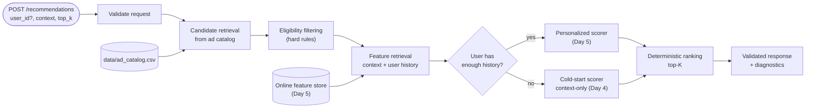

# Recommendation Engine Specification

The central deliverable of this project is a **working advertisement recommendation engine**. Given a request, it returns the top-K eligible ads for that user and context, built from these stages:

- candidate retrieval from an ad catalog
- eligibility filtering
- feature retrieval
- CTR-based scoring
- deterministic ranking

This document specifies that engine across the days that build it:

| Day | What it adds to the engine |
|---|---|
| [Day 4](ROADMAP.md#day-4--recommendation-engine-core-and-ranking-evaluation) | Core pipeline |
| [Day 5](ROADMAP.md#day-5--personalization-feature-engineering-and-feature-stores) | Personalization |
| [Day 6](ROADMAP.md#day-6--recommendations-api-and-low-latency-serving) | API |
| [Day 10](ROADMAP.md#day-10--integration-validation-and-independent-problem-solving) | End-to-end demonstration |

**Status:** 🗓️ planned. None of the modules below exist yet.

- **Interfaces are given as signatures only.** Contributors write the implementations and tests themselves, following the [learning method](CONTRIBUTING.md#learning-method).
- **Names are proposals.** Contributors may change them if they record the change in this file.

---

## 1. CTR prediction vs ranking vs a recommender system

| | CTR prediction | Ranking | Recommender system |
|---|---|---|---|
| **Question** | How likely is a click if *this* ad is shown in *this* context? | Given a set of candidates and their scores, in what order should they appear? | Which ads should this user see now, out of everything available? |
| **Input** | One (context, ad) pair | A candidate list plus scores | A request: user, context, top_k |
| **Output** | A probability in [0, 1] | An ordered top-K list | A validated response of recommended ads |
| **Evaluated by** | Log loss, ROC-AUC, PR-AUC, calibration, on logged impressions | Precision@K, Recall@K, NDCG@K, on candidate sets with **known** relevance | Ranking quality, coverage, cold-start behavior, latency, correctness of every stage, and ultimately online outcomes |
| **In this project** | Day 3 model, extended on Day 5 | Day 4 `rank` and ranking metrics | Days 4–6, demonstrated end to end on Day 10 |

A CTR model is **one component** of a recommender, and ranking is **one stage**. A complete recommender also has:

- a catalog to draw candidates from
- retrieval and hard eligibility rules that a score can never override
- features that are correct at request time
- a fallback for users with no history
- a validated response contract
- logging that feeds the next round of training

A strong CTR model on its own recommends nothing.

## 2. Request-to-response pipeline



| Stage | Responsibility | Never does |
|---|---|---|
| Retrieval | Returns a bounded set of plausible candidates from the catalog | Scoring with the CTR model |
| Eligibility | Applies yes/no rules (status, device, schedule, blocked categories, ➕ frequency cap) and counts rejections by reason | Uses a model score to override a rule |
| Feature retrieval | Builds the feature row for each candidate from the context and **past-only** user history | Reads events at or after `request_time` |
| Scoring | Returns one probability per candidate, in input order, in **one batched call** | Reorders or drops candidates |
| Ranking | Sorts by score descending, breaks ties by `ad_id` ascending, and truncates to `top_k` | Calls the model |

## 3. Data contracts

### 3.1 Ad catalog: `data/ad_catalog.csv` (new, hand-written on Day 4)

The impression logs contain only `ad_1`–`ad_4`, one per category, so the engine needs its own catalog. This is a **new, small, hand-written file**. The generated datasets and the generator stay unchanged.

| Column | Type | Meaning |
|---|---|---|
| `ad_id` | string, unique | Ad identifier; include `ad_1`–`ad_4` so that logged ads appear in the catalog |
| `ad_category` | string | One of the four logged categories, or a new one (see below) |
| `status` | `active` \| `paused` | Paused ads are never eligible |
| `allowed_devices` | `desktop`, `mobile`, or `desktop\|mobile` | Device targeting |
| `active_hour_start`, `active_hour_end` | int 0–23 | Delivery schedule in UTC; decide and test how a window that wraps past midnight works |

**Required coverage.** The catalog must include at least:

- two active ads in the same category, which tests tie-breaking
- one paused ad
- one ad for a single device only
- one ad with a limited schedule
- one ad in a category never seen in training, which tests unknown-category handling

Keep it to about 10–15 rows.

### 3.2 Core types (proposed, `src/recommender_types.py`)

```python
@dataclass(frozen=True)
class Ad:
    ad_id: str
    ad_category: str
    status: str                      # "active" | "paused"
    allowed_devices: frozenset[str]
    active_hours: tuple[int, int]    # (start, end), UTC

@dataclass(frozen=True)
class RequestContext:
    user_id: str | None              # None => anonymous => cold start
    device: str                      # "desktop" | "mobile"
    request_time: datetime           # timezone-aware UTC; hour is derived from it
    blocked_categories: frozenset[str] = frozenset()

@dataclass(frozen=True)
class ScoredAd:
    ad: Ad
    score: float                     # predicted CTR in [0, 1]

@dataclass(frozen=True)
class Recommendation:
    items: list[ScoredAd]            # ranked, len <= top_k
    scoring_path: str                # "context_only" | "personalized" | "cold_start"
    model_version: str
    diagnostics: dict                # retrieved, eligible, filtered_out by reason
```

## 4. Module interfaces

Only signatures and contracts are given here. Implementations and tests are the exercise.

```python
# src/catalog.py (Day 4)
def load_catalog(path: Path) -> list[Ad]: ...
    # Validates schema, unique ad_id, value domains; raises ValueError with the offending row.

# src/retrieval.py (Day 4)
def retrieve_candidates(catalog: Sequence[Ad], context: RequestContext,
                        max_candidates: int) -> list[Ad]: ...
    # Day 4: all catalog ads, deterministic order, at most max_candidates.
    # ➕ Day 5: category-affinity retrieval from user history (keep an exploration share).

# src/eligibility.py (Day 4; ➕ frequency cap on Day 5)
def filter_eligible(candidates: Sequence[Ad], context: RequestContext
                    ) -> tuple[list[Ad], dict[str, int]]: ...
    # Returns (eligible ads in input order, rejection counts keyed by reason).

# src/scoring.py (Day 4 context-only; Day 5 personalized)
class Scorer(Protocol):
    model_version: str
    def score(self, context: RequestContext, candidates: Sequence[Ad],
              user_features: Mapping[str, float] | None) -> list[float]: ...
    # One probability per candidate, same order, one batched model call.

# src/ranking.py (Day 4)
def rank(scored: Sequence[ScoredAd], top_k: int) -> list[ScoredAd]: ...
    # Score descending, ties by ad_id ascending; top_k < 1 -> ValueError; top_k > n -> all n.

# src/ranking_metrics.py (Day 4)
def precision_at_k(ranked_ids: Sequence[str], relevance: Mapping[str, float], k: int) -> float: ...
def recall_at_k(ranked_ids: Sequence[str], relevance: Mapping[str, float], k: int) -> float: ...
def ndcg_at_k(ranked_ids: Sequence[str], relevance: Mapping[str, float], k: int) -> float: ...
    # Relevance must be known for every ranked id; unknown (None) -> ValueError, never 0.

# src/recommender.py (Day 4, extended Day 5)
def recommend(context: RequestContext, top_k: int, *, catalog: Sequence[Ad],
              context_scorer: Scorer, personalized_scorer: Scorer | None = None,
              feature_store: "FeatureStore | None" = None) -> Recommendation: ...
    # Orchestrates retrieve -> filter -> features -> score -> rank. Contains no model logic itself.
```

## 5. Day 4: engine core with a context-only scorer

**Build:**

- the catalog file and loader
- retrieval
- eligibility
- a `Scorer` that wraps the Day 3 pipeline
- ranking
- `recommend()`
- ranking metrics
- the labeled ranking fixtures from [section 8](#8-offline-ranking-evaluation-and-labeled-fixtures)

**Observe and write down:**

- **Same-category ties.** The Day 3 model uses only device, category, and hour, so two ads in the same category always receive the same score. Tie-breaking decides their order.
- **Identical results for every user.** Every user with the same device and hour gets the same list. This is the context-only, unpersonalized baseline that Day 5 improves on.
- **Unknown categories.** An ad whose category the model never saw still gets a score from the encoder's handling of unknown values. Document what that score means.

**Required tests:**

| Module | Test cases |
|---|---|
| `catalog` | Valid file loads; a duplicate `ad_id`, an unknown status, or an hour out of range raises with the offending row |
| `retrieval` | Returns only catalog ads, with no duplicates, in deterministic order, respecting `max_candidates`; an empty catalog gives an empty list |
| `eligibility` | Each rule has a passing and a failing case; schedule boundaries, including the wrap-around decision; rejection counts add up to retrieved − eligible |
| `scoring` | One score per candidate, in order, each in [0, 1]; an unseen category does not crash |
| `ranking` | Scores descending; ties broken by `ad_id`; `top_k` of 0 or less raises; `top_k` larger than n returns n; empty input returns empty; the input is not mutated |
| `ranking_metrics` | Matches hand-computed values on the metric fixtures; an unknown label raises |
| `recommender` | With a **stub scorer** that gives a paused or blocked ad the highest score, that ad is still never returned; the same request twice gives an identical result; the result length is min(`top_k`, eligible) |

**Acceptance:**

- All tests above pass.
- `recommend()` returns a deterministic top-K for a sample request.
- A short note explains same-category ties and the lack of personalization.
- The ranking metrics are reported **only** on labeled fixtures (section 8), next to a random baseline and a popularity baseline (overall CTR by category).

## 6. Day 5: personalization, cold start, and time-correct features

### 6.1 The time-correctness rule

> A feature for a request at time *t* may use **only events with `event_time` < *t*.** Future clicks and conversions are never prediction-time features.

Concretely:

- **The current impression is excluded.** It is logged at *t* itself, so the strict `<` keeps it out. Its own click arrives at *t* + 5 s and its conversion at *t* + 45 s, so both are excluded as well.
- **Training rows use the same rule.** Each training impression's features are computed as of that impression's `event_time`.
- **Conversions are delayed labels.** A conversion counts as a feature only once its own `event_time` < *t*. In real systems, a conversion is not used as a *label* until its attribution window has closed.
- **The online store has a cut-off time.** A store materialized at time *S* contains events before *S*. A request with `request_time` < *S* would see the future, so the API must reject it (422), and offline evaluation must use as-of features instead. In production this cannot happen, because requests are always later than the snapshot.

### 6.2 Personalized scoring path

**User history features.** Compute them per user from the trailing window before *t*. For example:

- impressions and clicks over the last *N* hours
- clicks per category

**Candidate-dependent features.** These are computed for each (user, candidate) pair, so different candidates get different values. Example: the user's smoothed CTR on the candidate's category. *Hint:* shrink toward the global CTR, so that one click in two impressions does not look like 50%.

**Model and scorer.**

- Retrain the CTR model on context features plus these features, built with the same as-of rule.
- Wrap it in a second `Scorer`.
- `scoring_path = "personalized"`.

### 6.3 Cold-start fallback

**When it applies:** `user_id` is missing, the user is unknown to the feature store, or the user has fewer than `min_history` impressions before *t*. Choose `min_history`, for example 5, and document it.

**What it does:**

- Use the Day 4 context-only scorer.
- Set `scoring_path = "cold_start"`.

Never feed placeholder zeros silently into the personalized model.

### 6.4 Offline/online feature consistency checks

1. **Parity.** For a sample of (user, *t*) pairs, the offline as-of features must equal the online store's features when that store is materialized at *t*. Require exact equality for counts, and a tolerance for rates.
2. **One code path.** Training and serving call the same feature functions. Test this through the public functions, not by inspecting the code.
3. **Distribution check.** Compare summary statistics of the features in the training set with those of the features served during the Day 10 demo. Report any large difference as possible skew.

**Required tests:**

- Adding events at or after *t* leaves the features unchanged. Cover the current impression's own click and conversion.
- The parity check above.
- An unknown user, an anonymous user, and a user below `min_history` each take the cold-start path.
- A known user takes the personalized path.
- Two users with different histories can receive different rankings for the same context.
- A request earlier than the store's materialization time is rejected.

**Acceptance:**

- The tests pass.
- The personalized scorer is compared with the context-only scorer on the Day 3 test period, using classification metrics.
- On the labeled ranking fixtures, it is compared with the random and popularity baselines, using ranking metrics.

## 7. Day 6: `POST /recommendations`

### 7.1 Contract

**Request:**

```json
{
  "user_id": "u_000039",
  "context": { "device": "mobile", "request_time": "2026-01-22T19:00:00Z" },
  "top_k": 3,
  "blocked_categories": ["finance"]
}
```

| Field | Rule |
|---|---|
| `user_id` | Optional string; when omitted, the request takes the cold-start path |
| `context.device` | Required; `desktop` or `mobile` |
| `context.request_time` | Required ISO 8601 timestamp with a timezone; the hour is derived from it in UTC. It is required so that tests are deterministic, whereas a production server would set it itself |
| `top_k` | Integer, 1 ≤ `top_k` ≤ `MAX_TOP_K` (choose and document, e.g. 10); default 3 |
| `blocked_categories` | Optional list of strings; maximum length bounded |

**Response, 200.** The values below show the shape only; they are not expected results.

```json
{
  "request_id": "generated-uuid",
  "model_version": "ctr-personalized-2026-xx-xx",
  "scoring_path": "personalized",
  "recommendations": [
    { "rank": 1, "ad_id": "ad_x", "ad_category": "sports", "score": 0.0 }
  ],
  "diagnostics": { "retrieved": 0, "eligible": 0, "filtered_out": { "paused": 0 } }
}
```

**Status codes:**

- **200**, including when no ad is eligible. That response has an empty `recommendations` list and diagnostics explaining why.
- **422** for invalid input: an unknown device, `top_k` out of range, a timestamp without a timezone, a malformed body, or a request earlier than the store's materialization time.
- **The service fails at startup**, not per request, if the model or catalog cannot be loaded. `GET /health` reports readiness and model versions.

### 7.2 Output validation

Declare a Pydantic `response_model`. In addition, check these invariants in tests and ➕ optionally assert them in the service:

- `len(recommendations)` == min(`top_k`, number of eligible ads)
- `rank` values are 1..n, with no gaps
- scores are in [0, 1] and do not increase down the list
- `ad_id`s are unique and present in the catalog
- every returned ad is eligible for this request: active, correct device, in schedule, and not in a blocked category
- `scoring_path` is one of the documented values

### 7.3 Integration tests (`tests/test_api.py`)

Use FastAPI's `TestClient` with the fixture catalog. Use either a small trained model or the stub scorer from Day 4. Test cases:

- A valid request returns 200, and every output invariant above holds.
- A blocked category is never returned.
- A paused ad and a wrong-device ad are never returned.
- An anonymous user and an unknown user get `cold_start`; a known user gets `personalized`.
- An identical request returns an identical `recommendations` list.
- `top_k` larger than the number of eligible ads returns all eligible ads.
- Nothing eligible returns 200 with an empty list.
- Each invalid input in 7.1 returns 422.
- The response's `model_version` matches the loaded artifact.

**Acceptance:**

- The tests pass.
- The container serves `POST /recommendations`.
- `reports/latency.md` measures p50/p95/p99 for this endpoint, for both the cold-start and personalized paths.

## 8. Offline ranking evaluation and labeled fixtures

### 8.1 Why the impression logs cannot evaluate ranking without bias

- **One shown ad per request.** Each logged request shows exactly one ad, so the outcome for every other catalog ad in that context is **unknown**.
- **Unknown is not negative.** Treating unshown ads as non-clicks confuses "not shown" with "not relevant". It rewards models that imitate the logging policy, and it penalizes models that would surface good ads which were never shown.
- **Exposure and selection bias.** The logs reflect whatever policy chose the shown ads. In real systems, position effects add further bias. See [feedback loops](ARCHITECTURE.md#83-retraining-and-feedback-loops).
- **What the logs *are* good for.** Pointwise CTR evaluation on shown impressions: log loss, ROC-AUC, PR-AUC, calibration.
- **What real systems do instead.** Randomized exploration traffic, online A/B tests or interleaving, and counterfactual estimators such as inverse propensity scoring. These are out of scope here and are discussed on Day 9.

### 8.2 Labeled synthetic fixtures

Ranking metrics in this project run only on candidate sets where **every candidate's relevance is explicitly labeled** and the source of each label is recorded.

| Fixture | Location (proposed) | Label source | Used for |
|---|---|---|---|
| **A. Metric unit cases** | `tests/fixtures/ranking_metric_cases.json` | `hand_labeled`: tiny lists with graded relevance chosen by the contributors; expected metric values **computed by hand** and recorded in the file | Testing `precision_at_k`, `recall_at_k`, `ndcg_at_k`, including no relevant items, K > n, ties, and the AUC-vs-ranking example from [Day 4](ROADMAP.md#day-4--recommendation-engine-core-and-ranking-evaluation) |
| **B. Simulated full-information requests** | `tests/fixtures/ranking_requests.json`, generated by a small fixture builder | `synthetic_oracle` (see below) | Comparing context-only, personalized, random, and popularity rankers with Precision@K, Recall@K, NDCG@K |

**How fixture B gets its labels:**

- Each fixture user has a **declared preferred category** stored in the fixture itself.
- Each candidate's relevance is its **true click probability** under the generator's documented rule ([ARCHITECTURE §1](ARCHITECTURE.md#1-current-state-)): 0.05, plus 0.22 if the category matches the preference, plus 0.035 for hours 18–22.
- For binary metrics, use relevant = category matches the preference.
- The fixture builder re-implements this documented rule. It does not import or modify the generator.
- ➕ **Optional:** the preferences of the real dataset users can be recovered by replaying the generator's seeded draws. This was checked: the recovered matches show about 27% CTR, against about 6% for non-matches. It couples the fixture to the generator's internals, so pin the seed and add a test that fails loudly if the generator changes.

**Rules for both fixtures:**

- **Unknown relevance is `null`, never 0.** Metric functions must raise on `null`.
- **Ineligible candidates are marked `"eligible": false`.** They must never appear in a ranked list. Metrics are computed over eligible candidates only.
- **The model never sees the labels.** It is trained on the logs. In particular, the oracle preference is never a feature; it is used only for evaluation.
- **Report the label source next to every metric.** Oracle-labeled metrics measure how well a ranker recovers the *generator's* rule. They say nothing about real users.

**Schema example.** It shows the structure only; values are illustrative and there are no expected results:

```json
{
  "case_id": "evening-sports-fan-mobile",
  "label_source": "synthetic_oracle",
  "user": { "user_id": "fixture_user_1", "declared_preference": "sports" },
  "context": { "device": "mobile", "request_time": "2026-01-22T19:00:00Z" },
  "candidates": [
    { "ad_id": "ad_2", "ad_category": "sports",  "eligible": true,  "relevance": 0.305 },
    { "ad_id": "ad_1", "ad_category": "finance", "eligible": true,  "relevance": 0.085 },
    { "ad_id": "ad_9", "ad_category": "travel",  "eligible": false, "relevance": null }
  ]
}
```

## 9. Day 10: end-to-end demonstration

**The entry point.** A single entry point, such as a script or Makefile target, runs the pipeline from a fresh setup. It starts the API and sends at least these three requests:

1. A known user, taking the personalized path.
2. An anonymous or new user, taking the cold-start path.
3. A request with a blocked category and a device that excludes some ads.

**What each request must show.** For each request, the demo shows every stage in order. The response diagnostics or structured logs should be enough to show this:

1. request received
2. candidates retrieved from the catalog
3. eligibility filtering, with rejection counts by reason
4. features retrieved, and which scoring path was taken
5. scores computed
6. ranking and top-K
7. the validated response

**What else the demo runs:**

- The offline ranking evaluation on fixture B, with the label source shown.
- The `tests/test_api.py` integration tests.

**Acceptance:**

- A fresh clone reaches all three responses by following only the README.
- Every stage is visible.
- All tests pass.
- Each contributor can explain each stage and change one eligibility rule, with a test, during the review.

## 10. Out of scope

- Bids, budgets, pacing, auctions.
- Learned retrieval (embeddings, approximate nearest neighbor).
- Multi-slot page layout and diversity optimization.
- Counterfactual evaluation.

Where these would fit is discussed on Day 9.
