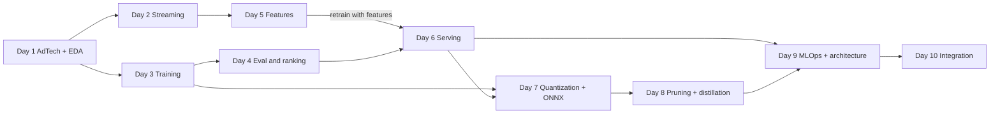

# 10-Day Roadmap

This is the detailed plan behind the summary in the [README](../README.md#9-10-day-roadmap). Each day lists:

- **Topics** to study
- **Build** steps
- **Deliverables**
- **Done when**: acceptance criteria, also summarized in the [README](../README.md#10-daily-deliverables-and-acceptance-criteria)
- **Explain**: questions both contributors should be able to answer

Days with more extensive learning material have their own guide: [Day 1](DAY1.md), [Day 7](DAY7.md), and [Day 8](DAY8.md).

Status markers: ✅ implemented · 🗓️ planned · ➕ optional. File names are suggestions until the code exists.

**Time budget:** about 3–4 hours per person per day, 30–40 hours in total. A typical day is 45–60 minutes of learning, 90–120 minutes of building a small, testable slice, and 45 minutes of verification, review, and explanation. Split each day into at least two tasks, and alternate implementer and reviewer so both people work on every layer. Follow the [learning method](CONTRIBUTING.md#learning-method): contributors write their own solutions, and the exercises give requirements, hints, and acceptance criteria, not answers.

**Dependencies between days:**



---

## Day 1 — AdTech Fundamentals, Python and Pandas

**Guide:** [DAY1.md](DAY1.md), in two parts: AdTech fundamentals, then data exploration. **Starting point ✅:** [explore_data.py](../explore_data.py) (prints shape, head, and label counts, with a CTR TODO).

**Topics**

- The AdTech request lifecycle, from ad slot to event logging
- Advertising ecosystem components: publishers, advertisers, DSPs, SSPs, exchanges, ranking services
- Candidate selection, scoring, and ranking
- Collecting click and impression events
- DataFrame and Series fundamentals
- Data validation and missing values
- Duplicates and unique identifiers
- CTR calculations
- `groupby`, aggregation, filtering, and sorting
- Identifying features and target variables
- Class imbalance and basic data leakage

**Build**

1. Study [Part 1 of DAY1.md](DAY1.md#part-1--adtech-fundamentals). Write the walkthrough of one end-to-end ad request using a real row from the dataset.
2. Load both CSVs and parse `event_time` as UTC datetimes.
3. Check shape, dtypes, missing values per column, duplicate `request_id` / `event_id`, label domains (`clicked`, `converted` ∈ {0, 1}), `hour` ∈ [0, 23], and `hour` consistent with `event_time`.
4. Count unique users, ads, categories, and devices. Check consistency between the two files.
5. Compute overall CTR, then CTR by `device`, `ad_category`, and `hour`, **always with impression counts**.
6. Move the reusable checks into `src/data_validation.py` and add `tests/test_data_validation.py`.
7. Write `reports/data_profile.md`: the observed patterns, the class balance, the limitations, and the ad-request walkthrough.

**Deliverables:** CTR by device; CTR by advertisement category; a data-quality report; an explanation of one end-to-end ad request.

**Done when:** one command reproduces the profile, the validation tests pass, and both contributors can explain the ad-request lifecycle, the target, the safe features, and the leakage columns without reading code aloud.

**Explain:** Where in the lifecycle do eligibility filters run, and why are they not a model? Does a higher CTR for a category mean the category *causes* clicks? Why does "always predict no click" score high accuracy here?

---

## Day 2 — Python, Large Files and Streaming Data Processing

**Topics**

- Python functions; dictionaries and `collections` (`Counter`, `defaultdict`)
- Iterators and generators (`yield`), and lazy evaluation
- File processing: the `csv` module, Pandas, JSON / JSON Lines transformations
- Chunked CSV reading (`pd.read_csv(..., chunksize=...)`)
- Streaming aggregation and incremental metrics (running counts and sums, never stored rows)
- Handling malformed records: decide whether to skip and count them or to raise
- Memory-efficient processing and its time and space complexity
- Unit testing

**Build**

1. A generator that yields validated impression rows. Malformed records are either skipped and counted, or raised as errors. Make that choice deliberately and document it.
2. A streaming aggregator that computes clicks and impressions per key (device, category, hour) in one pass.
3. A Pandas chunked version that merges partial aggregates.
4. A JSON Lines transformation, for example converting events to JSON Lines and aggregating them back.
5. Tests: streaming == in-memory `groupby` for several chunk sizes, including 1, a size that does not divide the row count, and a size larger than the file; an empty file; a missing column; malformed values.
6. Generate a larger file into a temporary directory, e.g. `--impressions 1000000 --out /tmp/adtech-large`. Record the runtime and peak memory of the in-memory and streaming approaches.

**Deliverables:** chunked CSV processing utility (`src/streaming.py`); streaming CTR calculation; tests against in-memory calculations; an explanation of memory usage and complexity.

**Done when:** the equivalence tests pass for every tested chunk size, and the notes give measured numbers along with the time and space complexity. For example: O(n) time, and O(k) memory for k distinct keys.

**Explain:** When is a generator better than a list? What state must a streaming aggregator keep, and what happens if the process crashes halfway? How would you compute a median in a streaming fashion?

---

## Day 3 — Classification and Model Training

**Topics**

- Supervised learning, features vs targets
- Logistic regression and regularization
- Categorical encoding (`OneHotEncoder(handle_unknown="ignore")`)
- Preprocessing pipelines
- Train / validation / test splits; random vs chronological splitting
- Data leakage: target leakage, post-outcome columns, preprocessing fitted on all data, future information
- Class imbalance: class weights vs resampling, and their effect on calibration
- Baseline models
- Model serialization (joblib) and versioning metadata

**Build**

1. Create `requirements.txt` that includes `requirements-day1.txt` and adds scikit-learn and joblib with version constraints.
2. Baseline: predict the training-set CTR for every row.
3. A chronological split on `event_time`, for example the first 70% for training, the next 15% for validation, and the last 15% for testing. Record a random split's metrics for comparison.
4. A scikit-learn `Pipeline(ColumnTransformer → LogisticRegression)` on `device`, `ad_category`, and `hour`. Decide, and document, whether `hour` is one-hot encoded or numeric. A linear model cannot learn an evening peak from a numeric hour. Day 5 features are added later.
5. Save the fitted pipeline to `models/` (git-ignored) together with metadata: version, training date range, features, metrics, and seed.
6. Tests: training is deterministic for a fixed seed; unseen category values do not crash prediction; `clicked`, `converted`, and `request_id` are not in the feature list.
7. Write `reports/model_card.md` with the measured baseline vs model metrics and the split description.

**Deliverables:** reproducible baseline training pipeline; trained CTR prediction model; saved model artifact; basic evaluation report.

**Done when:** `python -m src.train` produces the same artifact metrics twice in a row, and the report compares the model against the baseline on the held-out test period.

**Explain:** Why can a random split be optimistic when users repeat over time? Why fit the encoder on training data only? With no user features yet, can the model learn per-user preferences at all? Check what the generator actually does. What is the difference between *training* this model and *running inference* with it ([concepts](ARCHITECTURE.md#81-training-inference-serving-and-evaluation))?

---

## Day 4 — Classification and Ranking Evaluation

**Topics**

- Confusion matrix and thresholds
- Precision, recall, and F1
- ROC-AUC and PR-AUC; compare PR-AUC with the base rate
- Log loss
- Probability calibration: reliability curves, Brier score
- Ranking scores; top-K with stable tie-breaking
- Precision@K, Recall@K, NDCG@K
- Ranking evaluation grouped by request or user
- Model metrics vs business metrics vs operational metrics
- Limits of offline evaluation (selection and exposure bias, see [feedback loops](ARCHITECTURE.md#83-retraining-and-feedback-loops))

**Metric families.** Keep these separate in every report:

| Family | Examples | Question answered |
|---|---|---|
| Classification | Log loss, ROC-AUC, PR-AUC, precision, recall, F1, calibration | Are the per-impression probabilities good? |
| Ranking | Precision@K, Recall@K, NDCG@K | Is the order within each request or user list good? |
| Business | Online CTR, conversion rate, revenue, cost per acquisition, return on ad spend | Did outcomes improve? Measurable only with live traffic, such as an A/B test |
| Operational | p50/p95/p99 latency, error rate, cost per 1,000 requests | Can the system serve the model reliably and affordably? |

**Why good classification does not guarantee good ranking.** ROC-AUC compares *all* positive–negative pairs across the whole dataset, while ranking only compares candidates *within the same request*. Example:

- Request A: candidate 1 scores 0.90 (not clicked), candidate 2 scores 0.80 (clicked).
- Request B: candidate 1 scores 0.12 (not clicked), candidate 2 scores 0.10 (clicked).
- Requests C–H: two candidates each, all scored 0.05, none clicked.

Global ROC-AUC = 25/28 ≈ 0.89, because most negatives score far below both positives. Yet in **every** request that has a click, the clicked ad is ranked second, so Precision@1 = 0. The score differences *between* requests dominate the global metric and hide the errors *within* requests. Verify these numbers with your own metric implementations.

**Data caveat:** each `request_id` in this dataset has **one** shown ad, so per-request ranking metrics are undefined on the raw logs. Choose one approach and document it:

- **Grouped by user / time window:** treat a user's impressions within a window as the candidate list and their clicks as relevance labels.
- **Constructed candidates:** for each test impression, score all four categories under the same context. Use them for qualitative top-K demos only, because the counterfactual labels are unknown.

**Build**

1. `src/evaluate.py`: confusion matrix at a chosen threshold, precision, recall, F1, ROC-AUC, PR-AUC, log loss, and a calibration table, compared against the Day 3 baseline.
2. `src/ranking.py`: `rank(candidates, model, k)`, which returns the top-K sorted by score, with ties broken by a stable key such as `ad_id`. It validates `k` and handles empty input.
3. `precision_at_k`, `recall_at_k`, and `ndcg_at_k`, each tested against hand-computed examples. Include the example above and edge cases: no relevant items, and K larger than the list.
4. A short written comparison of the classification objective (calibrated probability per impression) and the ranking objective (correct order within a list), plus which business metric each would serve.

**Deliverables:** classification evaluation module; top-K candidate ranking; ranking metric implementations and tests; comparison of classification and ranking objectives.

**Done when:** all metric tests pass against hand-worked values, ranking output is deterministic, and the candidate-set approach and its limitations are written down.

**Explain:** Can a model have a good AUC and poor calibration? When would you optimize NDCG rather than log loss? Why can't offline metrics on logged data prove a business-metric improvement?

---

## Day 5 — Feature Engineering and Feature Stores

**Topics**

- Behavioral event aggregation
- User features (e.g., clicks per category over the last N hours) and advertisement features (e.g., trailing CTR)
- Online vs offline feature stores
- Feature freshness and time-to-live
- Point-in-time correctness: as-of joins, and the difference between event time and processing time
- Training-serving skew
- Delayed conversions: label windows, and why recent rows look like negatives
- Data leakage through features
- A simple feature-store architecture

**Build**

1. `src/features.py`: pure functions that compute features for `(user_id, as_of_time)` from events with `event_time < as_of_time`.
2. Offline path: compute point-in-time features for every training impression, using `pd.merge_asof` or an equivalent. Retrain the Day 3 model with these features and compare.
3. `src/feature_store.py`: a lightweight local store. It holds an offline table (DataFrame or CSV snapshot) and an online in-memory dict keyed by entity, with `get_online_features(user_id)` and a default for unknown users.
4. Tests:
   - Adding events **after** `as_of_time` does not change the features.
   - The offline and online paths return identical values for the same entity and time.
   - Unknown users get defaults.
   - Conversion-based features only count conversions whose label window has closed.
5. Add a feature-store section to [ARCHITECTURE.md](ARCHITECTURE.md#5-feature-store-day-5-): what a production feature store adds and why this project does not need one.

**Deliverables:** behavioral feature pipeline; simulated online/offline feature access; feature validation tests; architecture documentation.

**Done when:** the leakage and parity tests pass, and the retrained model's metrics are reported next to the Day 3 metrics.

**Scope:** no production feature-store product is required. A local implementation is enough to learn the concepts.

**Explain:** Which features go stale fastest? What breaks if the online store is updated more slowly than training assumed? How do delayed conversions bias a model trained on the last 24 hours?

---

## Day 6 — Low-Latency Inference and Model Serving

**Topics**

- Inference vs serving ([concepts](ARCHITECTURE.md#81-training-inference-serving-and-evaluation))
- FastAPI, HTTP and JSON, status codes
- Pydantic input validation and request limits
- Loading the model once at startup
- Ranking API design
- Docker images, layers, and slim base images
- Latency vs throughput; p50, p95, p99
- Batching (scoring all candidates in one call) and concurrency (sync vs async endpoints, workers)
- Horizontal scaling: replicas add throughput and reduce queueing under load, but not the compute time of one inference
- Caching, timeouts, fallbacks, and service reliability
- CPU/GPU trade-offs for small vs large models

**Build**

1. Add FastAPI, Uvicorn, Pydantic, and httpx to `requirements.txt`.
2. `src/api.py`:
   - `GET /health` returns status and model version.
   - `POST /rank` accepts the request context and a list of candidates, scores all candidates in **one batched model call**, and returns the ranked candidates with scores and the model version.
3. Handle errors explicitly. Return 422 for invalid input and a bounded candidate count. Fail fast on startup if the model is missing. If online features are missing, fall back to defaults and report it in the response.
4. Write `tests/test_api.py` with FastAPI's `TestClient`, covering valid requests, empty candidates, invalid K, oversized input, and unknown categories.
5. Write a `Dockerfile` and verify `docker build` and `docker run`, then make a request against the container.
6. `src/benchmark.py`: warm up, then send N requests at a fixed concurrency, and report p50, p95, p99, and requests per second. Compare per-candidate scoring with batched scoring. Record the conditions in `reports/latency.md`.
7. Notes on scaling and operations: worker count, horizontal replicas, caching features vs caching scores, timeouts, and why a GPU is unlikely to help this model.

**Deliverables:** working inference API; API tests; Docker setup; latency benchmark; an explanation of scaling and operational trade-offs.

**Done when:** the API tests pass, the container serves a correct response, and the latency report contains **measured** numbers with their conditions.

**Explain:** Why does p99 matter more than the mean for ad serving? What should the API return if the feature store times out? If p99 is too high, when would you add replicas and when would you optimize the model (Days 7–8)?

---

## Day 7 — Model Optimization I: Quantization and ONNX

**Guide:** [DAY7.md](DAY7.md) contains the concepts, a worked quantization example, the experiment steps, and the measurement method.

**Topics**

- FP32, FP16, and INT8 representations
- Floating-point reduction vs integer quantization
- Quantization scales and zero points
- Dynamic vs static quantization
- Post-training quantization (PTQ) vs quantization-aware training (QAT)
- Model export to ONNX; ONNX Runtime
- Operator and hardware compatibility
- Numerical parity
- Trade-offs between accuracy, model size, and latency
- [Model size vs data volume](ARCHITECTURE.md#82-model-size-vs-data-volume)

**Build:** a small FP32 neural-network baseline; ONNX export with a parity check; one INT8 quantization experiment; a benchmark of FP32 vs optimized; `reports/optimization.md`. Dependencies (PyTorch CPU, `onnx`, `onnxruntime`) are added and pinned on this day.

**Deliverables:** small suitable neural-network baseline; ONNX export where supported; quantization experiment; FP32 vs optimized benchmark; numerical-quality comparison. Measure artifact size, inference latency, prediction quality, and memory usage where practical.

**Done when:** the [Day 7 acceptance criteria](DAY7.md#acceptance-criteria) are met. Results are measured, not assumed, and an absence of speed-up is reported and explained.

---

## Day 8 — Model Optimization II: Pruning and Knowledge Distillation

**Guide:** [DAY8.md](DAY8.md) contains the concepts and bounded hands-on exercises for both techniques.

**Topics**

- Pruning:
  - magnitude-based weight pruning
  - structured vs unstructured pruning
  - weight-, neuron-, and channel-level removal
  - sparsity
  - fine-tuning after pruning
  - quality vs compression trade-offs
  - why unstructured sparsity may not speed up dense inference
- Knowledge distillation:
  - teacher and student models
  - soft targets
  - temperature
  - teacher/student training objectives
  - capacity and generalization trade-offs

**Build:** unstructured pruning at several sparsity levels, with fine-tuning; a structurally pruned model rebuilt with smaller layers; a teacher, a label-only student, and a distilled student with matched training settings; a combined Day 7–8 benchmark.

**Deliverables:** pruning experiment; teacher/student distillation experiment; benchmark summary; explanation of when each technique is appropriate.

**Done when:** the [Day 8 acceptance criteria](DAY8.md#acceptance-criteria) are met.

---

## Day 9 — Production MLOps and System Architecture

**Topics**

- End-to-end recommendation architecture; candidate generation vs ranking; where bidding and auctions would fit
- Data pipelines and event streaming; batch vs streaming trade-offs
- Model versioning and registration
- Champion/challenger, shadow, and canary deployment
- A/B testing: experiment assignment (randomization unit), primary and guardrail metrics, sample size, duration
- Model monitoring: feature drift, prediction drift, delayed-label performance
- Retraining decisions and model rollback ([retraining loop](ARCHITECTURE.md#83-retraining-and-feedback-loops))
- Latency SLOs and operational alerts
- PII handling, data minimization, logging, and access controls
- Reliability, scalability, and cost; capacity planning
- Production failure scenarios and recovery

**Build**

Time-box the writing: keep each `MLOPS.md` section to about one page, and split the sections between the two contributors.

1. Write `docs/MLOPS.md` with:
   - **Model deployment strategy:** versioning, champion/challenger, shadow → canary → A/B → full rollout ([retraining loop](ARCHITECTURE.md#83-retraining-and-feedback-loops)), a concrete rollback sequence
   - **Monitoring and alerting design:** metric → threshold rationale → alert → action, covering service, data, and model layers, including latency SLOs
   - **Experimentation strategy:** an A/B test design with assignment unit, primary and guardrail metrics, and sample-size reasoning
   - **Privacy and production-guardrail checklist:** PII, retention, access control, score bounds, fallbacks, kill switch
2. Update [ARCHITECTURE.md](ARCHITECTURE.md):
   - Bring the "current" diagram in line with the code.
   - Add a complete architecture diagram for a scaled-up version (events → stream and batch processing → feature store → retrieval → ranking → serving → logging → retraining).
   - Add a failure-mode table: component → failure → impact → detection → mitigation.
3. ➕ Optional:
   - Structured request logging in the API: request ID, model version, latency, and number of candidates. No raw user IDs.
   - A latency budget and a capacity estimate, with stated assumptions.
   - A small PSI script that compares feature distributions between the training and test periods.

**Deliverables:** complete architecture diagram; model deployment strategy; monitoring and alerting design; experimentation strategy; privacy and production-guardrail checklist; scaling and failure-handling trade-off analysis.

**Done when:** every alert names a metric, a threshold rationale, and an action; rollback is a concrete sequence of steps; the A/B design states the unit, the metrics, and the sample-size reasoning; and every failure mode has a detection method and a mitigation.

**Scope:** design and document. There is no requirement to implement Kubernetes or distributed streaming infrastructure.

**Explain:** How do you monitor CTR performance when conversions arrive days later? When should a retrained model *not* replace the champion? What is the cheapest change that would double the throughput: more replicas or an optimized model? Which fields would count as personal data with real users?

---

## Day 10 — Integration, Validation and Independent Problem-Solving

**Topics:** end-to-end integration; reproducibility; unit and integration testing; data-pipeline verification; model and API validation; performance benchmarking; independent Python problem-solving; code review and debugging; system design explanations; architecture trade-offs; project limitations and future improvements.

**Build**

1. Start from a fresh clone and a new virtual environment, and follow only the README. Fix every step that fails.
2. Add a single demo entry point, such as a script or Makefile target, that runs: generate → validate → features → train → evaluate → serve → rank.
3. Add an end-to-end smoke test.
4. Consolidate the Day 2, 6, 7, and 8 benchmark results into one table with their conditions.
5. **Independent problem-solving.** Each contributor solves two small Python problems without assistance, in under 30 minutes each, and adds tests. ➕ A third problem is optional. Examples:
   - Top-K from a stream with bounded memory.
   - Deduplicating events by ID while keeping the earliest.
   - Sessionizing a user's events by an inactivity gap.
   - Computing CTR per key from JSON Lines with malformed rows.
6. **Debugging exercise.** Each contributor injects a small bug in a branch for the other to find with tests and a debugger.
7. **Cross-review.** Each contributor reviews a module they did not write and explains it.
8. Write the architecture and trade-off report, then update the README status tables, the limitations, and the future roadmap.

➕ Optional: a GitHub Actions workflow that runs the tests on pull requests.

**Deliverables:** working end-to-end demonstration; passing applicable tests; reproducible setup; consolidated benchmark results; architecture and trade-off report; final technical project review.

**Done when:** a fresh clone reaches a ranked API response by following the README alone, all applicable tests pass, and both contributors can run, debug, and explain the whole system. The aim is an understandable, testable system, not a large collection of services.

---

## Final demonstration checklist

```text
1. Fresh clone and setup from the README
2. Walk through one ad request: lifecycle step → project component
3. Generate data; show the data-quality report and the streaming equivalence test
4. Train; show baseline vs model metrics and the split method
5. Show classification vs ranking metrics, including a case where they disagree
6. Show point-in-time feature tests
7. Start the API (in Docker); send POST /rank; show model version
8. Show latency results and the Day 7–8 optimization benchmark
9. Walk through deployment, monitoring, A/B, and rollback design
10. Each contributor explains one design trade-off and fixes one small bug
```
