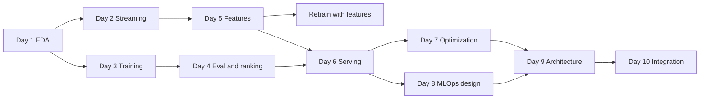

# 10-Day Roadmap

This is the detailed plan behind the summary in the [README](../README.md#9-10-day-roadmap). Each day lists:

- **Topics** to study
- **Build** steps
- **Deliverables**
- **Done when**: acceptance criteria, also summarized in the [README](../README.md#10-daily-deliverables-and-acceptance-criteria)
- **Discuss**: questions both contributors should be able to answer

Status markers: ✅ implemented · 🗓️ planned · ➕ optional. File names are suggestions until the code exists.

**Daily rhythm, per person, about 3 hours:** 45 minutes learning → 90 minutes building a small, testable slice → 45 minutes testing, reviewing, and writing down one trade-off. Split each day into at least two tasks, and alternate implementer and reviewer so both people work on every layer. See [CONTRIBUTING.md](CONTRIBUTING.md).

**Dependencies between days:**



---

## Day 1 — Python, Pandas and Data Exploration

**Starting point ✅:** [explore_data.py](../explore_data.py) (prints shape, head, and label counts, with a CTR TODO) and the guided exercise in [DAY1.md](DAY1.md).

**Topics**

- DataFrame and Series fundamentals
- Data types, shapes, missing values, and duplicate detection
- Unique values and data validation
- Filtering, sorting, grouping, and aggregation
- Click-through-rate calculation
- CTR by device and by advertisement category
- Class imbalance and basic statistical interpretation (sample size, confidence intervals)

**Build**

1. Load both CSVs and parse `event_time` as UTC datetimes.
2. Check shape, dtypes, missing values per column, duplicate `request_id` / `event_id`, label domains (`clicked`, `converted` ∈ {0, 1}), `hour` ∈ [0, 23], and `hour` consistent with `event_time`.
3. Count unique users, ads, categories, and devices.
4. Compute overall CTR, then CTR by `device`, by `ad_category`, and by `hour`, **always with impression counts**.
5. Check consistency between the files: every click event has a matching impression with `clicked == 1`.
6. Move the reusable checks into `src/data_validation.py` and add `tests/test_data_validation.py`.
7. Write `reports/data_profile.md`: the observed patterns, the class balance, and what this data *cannot* tell you.

**Deliverables:** reproducible EDA script, data-quality checks with tests, CTR breakdowns, and short pattern/limitation notes.

**Done when:** one command reproduces the profile, the validation tests pass, and both contributors can explain the target, the safe features, and the leakage columns without reading code aloud.

**Discuss:** Does a higher CTR for a category mean the category *causes* clicks? How large must a group be before its CTR difference means anything? Why does "always predict no click" score high accuracy here?

---

## Day 2 — Python Data Processing and Streaming

**Topics**

- Functions, dictionaries, and `collections` (`Counter`, `defaultdict`)
- Iterators and generators (`yield`), and lazy evaluation
- Reading CSV (`csv` module, Pandas) and JSON / JSON Lines
- Transformations and row-level validation
- Large-file processing, `pd.read_csv(..., chunksize=...)`
- Memory-efficient aggregation (keep running counts, not rows)
- Error handling (bad rows, missing columns) and unit testing

**Build**

1. A generator that yields validated impression rows from the CSV, either skipping or raising on bad rows. Make that choice deliberately and document it.
2. A streaming aggregator that computes clicks and impressions per key (device, category, hour) in one pass.
3. A Pandas chunked version, `read_csv(chunksize=N)`, that merges partial aggregates.
4. Tests: streaming == in-memory `groupby` for several chunk sizes, including 1, a size that does not divide the row count, and a size larger than the file; an empty file; a missing column; a malformed value.
5. Generate a larger file into a temporary directory, e.g. `--impressions 1000000 --out /tmp/adtech-large`, and record runtime and peak memory (`tracemalloc` or `/usr/bin/time`) for the in-memory and streaming approaches.

**Deliverables:** `src/streaming.py`, streaming CTR aggregation, equivalence tests, and memory/performance notes.

**Done when:** the equivalence tests pass for every tested chunk size, and the notes give measured numbers with the machine and file size used.

**Discuss:** When is a generator better than a list? What state must a streaming aggregator keep, and what happens if the process crashes halfway? How would you compute a median in a streaming fashion?

---

## Day 3 — ML Classification and Training

**Topics**

- Supervised learning, features vs target
- Train / validation / test splits; random vs time-based splitting
- Data leakage: target leakage, post-outcome columns, preprocessing fitted on all data, future information
- Preprocessing and categorical encoding (`OneHotEncoder(handle_unknown="ignore")`)
- Logistic regression baseline and regularization
- Class imbalance: class weights vs resampling, and their effect on calibration
- Model serialization (joblib) and versioning metadata

**Build**

1. Create `requirements.txt` that includes `requirements-day1.txt` and adds scikit-learn and joblib with version constraints.
2. Baseline: predict the training-set CTR for every row.
3. A time-based split on `event_time`, for example the first 70% for training, the next 15% for validation, and the last 15% for testing. Record a random split's metrics for comparison.
4. A scikit-learn `Pipeline(ColumnTransformer → LogisticRegression)` on `device`, `ad_category`, and `hour`. Day 5 features are added later.
5. Save the fitted pipeline to `models/` (git-ignored) together with metadata: version, training date range, features, metrics, and seed.
6. Tests: training is deterministic for a fixed seed; unseen category values do not crash prediction; `clicked`, `converted`, and `request_id` are not in the feature list.
7. Write `reports/model_card.md` with the measured baseline vs model metrics and the split description.

**Deliverables:** reproducible training pipeline, baseline CTR model, saved artifact with metadata, and basic evaluation report.

**Done when:** `python -m src.train` produces the same artifact metrics twice in a row, and the report compares the model against the baseline on the held-out test period.

**Discuss:** Why can a random split be optimistic when users repeat over time? Why fit the encoder on training data only? With no user features yet, can the model learn per-user preferences at all? Check what the generator actually does.

---

## Day 4 — Model Evaluation and Ranking

**Topics**

- Confusion matrix, thresholds, precision and recall
- ROC-AUC and PR-AUC; compare PR-AUC with the base rate
- Log loss and calibration
- Ranking and candidate scoring; top-K with stable tie-breaking
- Precision@K and NDCG@K
- Ranking evaluation grouped by request or user
- Limits of offline evaluation (selection bias, logged-policy bias)

**Data caveat:** each `request_id` in this dataset has **one** shown ad, so per-request ranking metrics are undefined on the raw logs. Choose one approach and document it:

- **Grouped by user / time window:** treat a user's impressions within a window as the candidate list and their clicks as relevance labels.
- **Constructed candidates:** for each test impression, score all four categories under the same context. Use them for qualitative top-K demos only, because the counterfactual labels are unknown.

**Build**

1. `src/evaluate.py`: confusion matrix at a chosen threshold, precision, recall, ROC-AUC, PR-AUC, and log loss, compared against the Day 3 baseline.
2. `src/ranking.py`: `rank(candidates, model, k)`, which returns the top-K sorted by score, with ties broken by a stable key such as `ad_id`. It validates `k` and handles empty input.
3. `precision_at_k` and `ndcg_at_k`, each with tests against hand-computed examples, including edge cases: no relevant items, and K larger than the list.
4. A short written comparison of the classification objective (calibrated probability per impression) and the ranking objective (correct order within a list).

**Deliverables:** classification evaluation module, top-K ranking, ranking metrics with tests, and the objective comparison.

**Done when:** all metric tests pass against hand-worked values, ranking output is deterministic, and the candidate-set approach and its limitations are written down.

**Discuss:** Can a model have a good AUC and poor calibration? When would you optimize NDCG rather than log loss? Why does offline ranking improvement not guarantee online improvement?

---

## Day 5 — Feature Engineering and Feature Stores

**Topics**

- Aggregating behavioral events
- User-level features (e.g., clicks per category over the last N hours) and ad-level features (e.g., trailing CTR)
- Event timestamps, feature freshness, and time-to-live
- Offline feature computation (batch, for training)
- Online feature lookup (low latency, for serving)
- Point-in-time correctness: as-of joins, and the difference between event time and processing time
- Training-serving skew
- Feature-store architecture and trade-offs

**Build**

1. `src/features.py`: pure functions that compute features for `(user_id, as_of_time)` from events with `event_time < as_of_time`.
2. Offline path: compute point-in-time features for every training impression, using `pd.merge_asof` or an equivalent. Retrain the Day 3 model with these features and compare.
3. `src/feature_store.py`: a lightweight local store. It holds an offline table (DataFrame or Parquet/CSV snapshot) and an online in-memory dict keyed by entity, with `get_online_features(user_id)` and a default for unknown users.
4. Tests:
   - Adding events **after** `as_of_time` does not change the features.
   - The offline and online paths return identical values for the same entity and time.
   - Unknown users get defaults.
5. Add a feature-store section to [ARCHITECTURE.md](ARCHITECTURE.md): what a production feature store adds (registry, materialization, TTL, backfills) and why this project does not need one.

**Deliverables:** behavioral feature pipeline, simulated offline and online feature access, feature validation tests, and architecture notes.

**Done when:** the leakage and parity tests pass, and the retrained model's metrics are reported next to the Day 3 metrics.

**Scope:** do not add external feature-store infrastructure. A local implementation is enough to learn the concepts.

**Discuss:** Which features go stale fastest? What breaks if the online store is updated more slowly than training assumed? How would you backfill a new feature?

---

## Day 6 — Model Serving and Low-Latency Inference

**Topics**

- FastAPI, HTTP methods and status codes, JSON
- Pydantic input validation and request limits
- Loading the model once at startup; inference per request
- Candidate ranking API design
- Docker images, layers, and slim base images
- Latency vs throughput; p50, p95, p99
- Concurrency (sync vs async endpoints, workers), caching, timeouts, failure handling and fallbacks

**Build**

1. Add FastAPI, Uvicorn, Pydantic, and httpx to `requirements.txt`.
2. `src/api.py`:
   - `GET /health` returns status and model version.
   - `POST /rank` accepts the request context and a list of candidates, and returns the ranked candidates with scores and the model version.
3. Handle errors explicitly. Return 422 for invalid input and a bounded candidate count. Fail fast on startup if the model is missing. If online features are missing, fall back to defaults and report it in the response.
4. Write `tests/test_api.py` with FastAPI's `TestClient`, covering valid requests, empty candidates, invalid K, oversized input, and unknown categories.
5. Write a `Dockerfile` and verify `docker build` and `docker run`, then make a request against the container.
6. `src/benchmark.py`: warm up, then send N requests at a fixed concurrency, and report p50, p95, p99, and requests per second. Record the hardware, the concurrency, and whether the numbers include HTTP overhead in `reports/latency.md`.
7. Notes on scaling: horizontal replicas, worker count, a cache for features versus a cache for scores, and timeouts.

**Deliverables:** working prediction API, API tests, Docker configuration, latency benchmark, and scaling trade-off notes.

**Done when:** the API tests pass, the container serves a correct response, and the latency report contains **measured** numbers with their conditions.

**Discuss:** Why does p99 matter more than the mean for ad serving? What should the API return if the feature store times out? What is safe to cache, and for how long?

---

## Day 7 — Model Optimization

**Topics**

- Quantization (post-training, dynamic and static; INT8)
- Pruning (structured vs unstructured)
- Knowledge distillation (teacher → student)
- ONNX export and ONNX Runtime inference
- Trade-offs between model size, latency, memory, and accuracy
- CPU vs GPU inference: batch size, transfer overhead, and when a GPU does not help

**Build: one measured experiment**

1. Export the Day 3/5 scikit-learn pipeline to ONNX with `skl2onnx`.
2. Check numerical parity: the maximum absolute difference in predicted probabilities on the test set must stay below a stated tolerance.
3. Benchmark single-row and batched latency, file size, and memory for scikit-learn and ONNX Runtime, with warm-up and repeated runs.
4. Write `reports/optimization.md` with the results, plus a short section on each of the other techniques: what it does, when it helps, and why it was or was not applied here. Quantization, pruning, and distillation mostly matter for large neural models, not small logistic regressions.

**Optional ➕:** a small PyTorch MLP CTR model on which dynamic quantization or distillation shows a measurable effect.

**Deliverables:** optimization study, one practical experiment, benchmark comparison, and an explanation of when each technique is useful.

**Done when:** parity is verified, the benchmark reproduces, and the conclusions follow from the measured numbers, even if the result is "no meaningful gain".

**Discuss:** Why might ONNX Runtime be slower than native inference for one tiny request? At what model size or traffic level would a GPU pay off?

---

## Day 8 — Production MLOps and Reliability

**Topics**

- Deployment strategies: blue/green, canary, shadow
- Model versioning and a model registry (conceptually)
- Champion/challenger
- A/B testing: randomization unit, metrics, guardrail metrics, sample size, duration
- Monitoring and alerting: service, data, and model layers
- Data drift (e.g., PSI) vs model performance drift; delayed labels
- Retraining triggers, promotion criteria, and rollback
- PII handling, data minimization, retention, and access control
- Production guardrails: score bounds, fallbacks, kill switches
- Structured logging and observability

**Build**

1. Write `docs/MLOPS.md` with:
   - A production-readiness checklist
   - A monitoring design (metric → threshold → alert → action)
   - A deployment and rollback strategy using the Day 3 artifact versioning
   - An A/B test design
   - Privacy and security considerations
2. Add structured request logging to the API: request ID, model version, latency, and number of candidates. Do not log raw user IDs.
3. ➕ Optional: a small PSI script that compares feature distributions between the training and test periods.

**Deliverables:** production-readiness checklist, monitoring design, deployment and rollback strategy, A/B test design, and privacy and security notes.

**Done when:** every alert names a metric, a threshold rationale, and an action; rollback is a concrete sequence of steps; and the A/B design states the unit, primary and guardrail metrics, and sample-size reasoning.

**Discuss:** How do you monitor CTR performance when clicks arrive late? What would make you roll back automatically rather than ask a human? Which fields in this project would count as personal data with real users?

---

## Day 9 — End-to-End ML System Architecture

**Topics**

- Candidate generation (retrieval) vs ranking (scoring) stages
- Personalization architecture
- Batch vs streaming pipelines
- Consistency between online and offline features
- Distributed data processing (where Spark or Flink would fit)
- Designing for low-latency inference within a latency budget
- Capacity planning (QPS × candidates × per-item cost)
- Reliability and scalability, failure scenarios and recovery
- Cost and performance trade-offs

**Build**

1. Update [ARCHITECTURE.md](ARCHITECTURE.md) so that it reflects the code that actually exists, and keep the planned extensions clearly separate.
2. Add an end-to-end diagram for a scaled-up version: event ingestion → stream and batch processing → feature store → retrieval → ranking → serving → logging → retraining.
3. Write a latency budget and a capacity estimate, with every assumption stated.
4. Produce a failure-mode table: component → failure → impact → detection → mitigation.

**Deliverables:** end-to-end architecture diagram, system design documentation, trade-off analysis, and scaling and reliability notes.

**Done when:** the "current" diagram matches the repository, and every estimate shows its assumptions.

**Discuss:** Why split retrieval from ranking? What do you lose by computing features in batch hourly rather than streaming them? What is the cheapest change that would double the throughput?

---

## Day 10 — Integration, Validation and Project Review

**Topics:** end-to-end integration, data pipeline verification, model and API testing, performance benchmarking, independent debugging, code review, reproducibility, technical documentation, and future planning.

**Build**

1. Start from a fresh clone and a new virtual environment, and follow only the README. Fix every step that fails.
2. Add a single demo entry point, such as a script or Makefile target, that runs: generate → validate → features → train → evaluate → serve → rank.
3. Add an end-to-end smoke test.
4. ➕ Optional: a GitHub Actions workflow that runs the tests on pull requests.
5. Debugging exercise: each contributor injects a small bug in a branch for the other to find with tests and a debugger.
6. Cross-review: each contributor reviews a module they did not write and explains it.
7. Update the README status tables, record the limitations, and write the future roadmap.

**Deliverables:** working end-to-end demo, passing automated tests, reproducible setup instructions, final architecture documentation, and project limitations with a future roadmap.

**Done when:** a fresh clone reaches a ranked API response by following the README alone, all tests pass, and both contributors can run, debug, and explain the whole system.

---

## Final demonstration checklist

```text
1. Fresh clone and setup from the README
2. Generate data and show the data-quality report
3. Show the streaming vs in-memory equivalence test
4. Train; show baseline vs model metrics and the split method
5. Show ranking metrics and a top-K example
6. Show point-in-time feature tests
7. Start the API (in Docker); send POST /rank; show model version
8. Show the latency report and the optimization comparison
9. Walk through the monitoring, rollout, and rollback design
10. Each contributor explains one design trade-off and fixes one small bug
```
